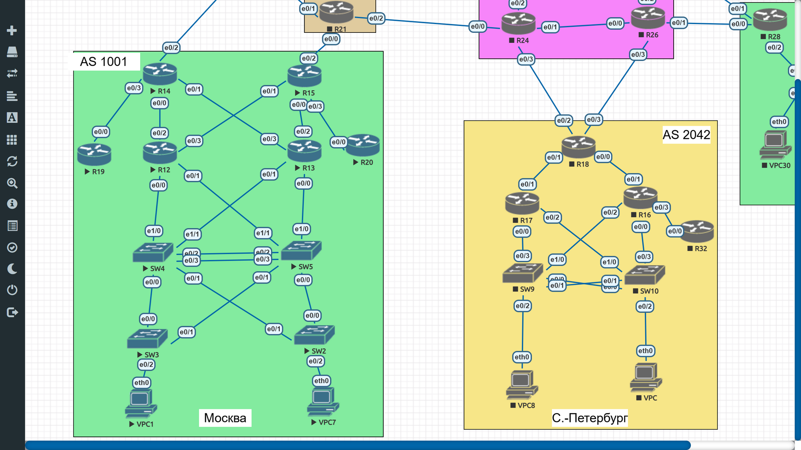

# OSPF: многозонная конфигурация



Офис Москва (AS 1001): R12 и R13 с пользовательскими VLAN (настроены в [работе 1](../1.%20Проектирование%20сети/README.md)), ABR R14 и R15, периферийные R19 и R20, коммутаторы SW2, SW3, SW4, SW5 и пинг-машины VPC1 (VLAN 10) и VPC7 (VLAN 20). Линк R14 e0/2 (10.0.100.0/30) уходит к R22, линк R15 e0/2 (10.0.100.12/30) к R21: оба в другие AS и в OSPF не участвуют.

## 1. Задача и допущения

Требования задания:

1. R14 и R15 в зоне 0 (backbone).
2. R12 и R13 в зоне 10, дополнительно получают маршрут по умолчанию.
3. R19 в зоне 101, получает только маршрут по умолчанию.
4. R20 в зоне 102, получает все маршруты, кроме сетей зоны 101.
5. Логика повторяется для IPv6.
6. План и изменения зафиксированы в документации.

Решения, которые я принял до работы со стендом:

- Зона 0 логически разорвана: R14 и R15 не соединены напрямую, все их порты заняты, физический линк добавить нельзя. В зоне 0 лежат только Loopback0 у R14 (10.0.0.14/32) и R15 (10.0.0.15/32), adjacency между ABR нет. Что из этого выходит для маршрутизации, показал стенд, всё описано по факту в разделе 6.
- Virtual link я не использовал: тема вне программы занятия, и через stub-зону virtual link в принципе невозможен ([RFC 2328, раздел 3.6](https://www.rfc-editor.org/rfc/rfc2328#section-3.6)).
- IPv6: вся логика зон повторена на OSPFv3 (процесс 6, те же типы зон, range, фильтр). Конфиги, два бага, найденные по дороге, и проверки: раздел 10.
- Зона 10: stub. ABR (R14, R15) автоматически вставляют в stub-зону default 0.0.0.0/0, так что пункт 2 (маршрут по умолчанию для R12 и R13) закрывается без отдельной команды.
- Зона 101: totally stubby: `area 101 stub no-summary` на ABR R14, `area 101 stub` на R19. R19 получает только default, type 3 LSA в зону не проходят.
- Зона 102: обычная. Чтобы выполнить пункт 4, на ABR R15 стоит фильтр `area 102 filter-list prefix NO-AREA101 in`, который не выпускает в зону 102 сети зоны 101: 10.0.0.19/32 (loopback R19) и 10.0.1.8/30 (линк R14 R19).
- Суммаризация: `area 10 range 10.11.0.0 255.255.0.0` на R14 и R15. Три пользовательских /24 Москвы (10, 20, 99) сворачиваются в один /16 в LSA, уходящих из зоны 10.
- NSSA в конфигурацию не вошёл: внешних маршрутов в Москве нет, ASBR нет. Типы зон с NSSA я разберу в разделе 3, чтобы закрыть тему занятия.

| Зона | Тип | Роутеры | Зачем |
|---|---|---|---|
| 0 | backbone (разорвана) | R14, R15 | по заданию, ABR |
| 10 | stub | R12, R13, R14, R15 | офис, external маршруты не нужны, ABR вставит default |
| 101 | totally stubby | R19, R14 | максимум упрощения: только default |
| 102 | обычная + фильтр на R15 | R20, R15 | все маршруты, кроме сетей зоны 101 |

Интерфейсы, включённые в OSPF, плюс два линка, которые намеренно не включил:

| Роутер | Интерфейс | Сеть | Зона |
|---|---|---|---|
| R12 | Loopback0 | 10.0.0.12/32 | 10 |
| R12 | e0/0.10 | 10.11.10.0/24 | 10 |
| R12 | e0/0.99 | 10.11.99.0/24 | 10 |
| R12 | e0/1.20 | 10.11.20.0/24 | 10 |
| R12 | e0/2 | 10.0.1.0/30 (к R14) | 10 |
| R12 | e0/3 | 10.0.1.16/30 (к R15) | 10 |
| R13 | Loopback0 | 10.0.0.13/32 | 10 |
| R13 | e0/0.10 | 10.11.10.0/24 | 10 |
| R13 | e0/0.99 | 10.11.99.0/24 | 10 |
| R13 | e0/1.20 | 10.11.20.0/24 | 10 |
| R13 | e0/3 | 10.0.1.4/30 (к R14) | 10 |
| R13 | e0/2 | 10.0.1.12/30 (к R15) | 10 |
| R14 | Loopback0 | 10.0.0.14/32 | 0 |
| R14 | e0/0 | 10.0.1.0/30 (к R12) | 10 |
| R14 | e0/1 | 10.0.1.4/30 (к R13) | 10 |
| R14 | e0/3 | 10.0.1.8/30 (к R19) | 101 |
| R14 | e0/2 | 10.0.100.0/30 (к R22) | вне OSPF |
| R15 | Loopback0 | 10.0.0.15/32 | 0 |
| R15 | e0/0 | 10.0.1.12/30 (к R13) | 10 |
| R15 | e0/1 | 10.0.1.16/30 (к R12) | 10 |
| R15 | e0/3 | 10.0.1.20/30 (к R20) | 102 |
| R15 | e0/2 | 10.0.100.12/30 (к R21) | вне OSPF |
| R19 | Loopback0 | 10.0.0.19/32 | 101 |
| R19 | e0/0 | 10.0.1.8/30 (к R14) | 101 |
| R20 | Loopback0 | 10.0.0.20/32 | 102 |
| R20 | e0/0 | 10.0.1.20/30 (к R15) | 102 |

R12 и R13 были настроены ещё в работе 1: IP на саб-интерфейсах, HSRP (vIP 10.11.10.1 у R12/R13, vIP 10.11.20.1), управление. В эту работу на них добавил только OSPF.

## 2. С чего я начал

Перед изменениями на R12, R14, R15, R19, R20 снял `show ip route` и `show ip ospf neighbor`. OSPF нигде не был настроен, у каждого роутера только connected-сети:

```text
R14#show ip route
    10.0.0.0/8 is variably subnetted, 9 subnets, 2 masks
C        10.0.0.14/32 is directly connected, Loopback0
C        10.0.1.0/30 is directly connected, Ethernet0/0
C        10.0.1.4/30 is directly connected, Ethernet0/1
C        10.0.1.8/30 is directly connected, Ethernet0/3
C        10.0.100.0/30 is directly connected, Ethernet0/2
```

```text
R19#show ip route
    10.0.0.0/8 is variably subnetted, 3 subnets, 2 masks
C        10.0.0.19/32 is directly connected, Loopback0
C        10.0.1.8/30 is directly connected, Ethernet0/0
```

Из этого я взял две отправные точки: какие connected-сети были до, и что ни один роутер не знает ни адресов VLAN, ни loopback'ов соседей.

## 3. План и порядок

Порядок я выстроил так, чтобы каждый этап можно было проверить до следующего:

1. Снять базовое состояние (раздел 2).
2. R12 и R13: зона 10, stub. Проверка: оба видят своих ABR.
3. R14 и R15: ABR, зоны 10, 101, 102. Проверка: `show ip ospf neighbor`, все adjacency FULL.
4. R19 (зона 101) и R20 (зона 102). Проверка: таблицы маршрутов, «до фильтра».
5. Суммаризация зоны 10: `area 10 range 10.11.0.0 255.255.0.0` на обоих ABR. Проверка: у R20 один /16 вместо трёх /24.
6. Фильтр на R15: prefix-list + `area 102 filter-list prefix NO-AREA101 in`. Проверка: таблицы R20 и R15, prefix-list.
7. Финальная матрица пингов (раздел 5).
8. `copy running-config startup-config` на всех шести роутерах.

По типам зон (тема занятия) для ориентира:

| Тип | External LSA (5) | Inter-area LSA (3) | Default от ABR | Когда применять |
|---|---|---|---|---|
| Обычная | да | да | нет | зоны, которым нужны все маршруты |
| Stub | нет | да | да | периметр сети, внешние маршруты не нужны |
| Totally stubby | нет | нет | да | максимум упрощения таблицы, только default |
| NSSA | да, но локальные (type 7) | да | да | зона со своим ASBR |
| Totally NSSA | да, но локальные (type 7) | нет | да | NSSA плюс подавление type 3 |

В этой работе использованы обычная (102), stub (10) и totally stubby (101).

## 4. Ход работы

### 4.1 R12 и R13: зона 10, stub

R12:

```text
router ospf 1
 log-adjacency-changes
 area 10 stub
 passive-interface default
 no passive-interface Ethernet0/2
 no passive-interface Ethernet0/3
!
interface Loopback0
 ip ospf 1 area 10
!
interface Ethernet0/0.10
 ip ospf 1 area 10
!
interface Ethernet0/0.99
 ip ospf 1 area 10
!
interface Ethernet0/1.20
 ip ospf 1 area 10
!
interface Ethernet0/2
 ip ospf 1 area 10
!
interface Ethernet0/3
 ip ospf 1 area 10
```

R13 то же самое, с перестановкой портов: e0/3 к R14, e0/2 к R15.

Почему так:

- `area 10 stub` нужен на каждом роутере зоны, включая ABR. Stub-зона не принимает external LSA (type 5), а ABR автоматически вставляют в неё default: это и есть маршрут по умолчанию для R12 и R13 из пункта 2 задания.
- `passive-interface default` + `no passive-interface` гасят hello на всех интерфейсах, кроме двух P2P-линков до ABR. Саб-интерфейсы к пользовательским VLAN остаются пассивными: hello в VLAN без роутеров не нужно.
- В IOS OSPF включается на интерфейсе явно командой `ip ospf 1 area N`, поэтому линки вне OSPF достаточно просто не настраивать.

### 4.2 R14 и R15: ABR

R14:

```text
router ospf 1
 log-adjacency-changes
 area 10 stub
 area 101 stub no-summary
!
interface Loopback0
 ip ospf 1 area 0
!
interface Ethernet0/0
 ip ospf 1 area 10
!
interface Ethernet0/1
 ip ospf 1 area 10
!
interface Ethernet0/3
 ip ospf 1 area 101
```

R15:

```text
router ospf 1
 log-adjacency-changes
 area 10 stub
!
interface Loopback0
 ip ospf 1 area 0
!
interface Ethernet0/0
 ip ospf 1 area 10
!
interface Ethernet0/1
 ip ospf 1 area 10
!
interface Ethernet0/3
 ip ospf 1 area 102
```

`no-summary` действует только на ABR, поэтому на R14 стоит `area 101 stub no-summary`, а R15 эту зону не знает. Линки e0/2 на обоих ABR (к R22 и R21, другие AS) в OSPF не включил.

Проверка adjacency на обоих ABR:

```text
R14#show ip ospf neighbor
Neighbor ID   Pri   State         Dead Time   Address       Interface
10.0.0.13     1     FULL/DR       00:00:32    10.0.1.5      Ethernet0/1
10.0.0.12     1     FULL/DR       00:00:39    10.0.1.1      Ethernet0/0
10.0.0.19     1     FULL/BDR      00:00:31    10.0.1.10     Ethernet0/3

R15#show ip ospf neighbor
Neighbor ID   Pri   State         Dead Time   Address       Interface
10.0.0.12     1     FULL/DR       00:00:36    10.0.1.17     Ethernet0/1
10.0.0.13     1     FULL/DR       00:00:34    10.0.1.13     Ethernet0/0
10.0.0.20     1     FULL/BDR      00:00:32    10.0.1.22     Ethernet0/3
```

Все adjacency FULL. Соседей в зоне 0 нет: ABR физически не соединены, это осознанное состояние, а не ошибка.

### 4.3 R19 (зона 101) и R20 (зона 102)

R19:

```text
router ospf 1
 log-adjacency-changes
 area 101 stub
!
interface Loopback0
 ip ospf 1 area 101
!
interface Ethernet0/0
 ip ospf 1 area 101
```

R20:

```text
router ospf 1
 log-adjacency-changes
!
interface Loopback0
 ip ospf 1 area 102
!
interface Ethernet0/0
 ip ospf 1 area 102
```

Таблица R19 после поднятия OSPF:

```text
R19#show ip route
Gateway of last resort is 10.0.1.9 to network 0.0.0.0

O*IA   0.0.0.0/0 [110/11] via 10.0.1.9, 00:06:10, Ethernet0/0
    10.0.0.0/8 is variably subnetted, 3 subnets, 2 masks
C        10.0.0.19/32 is directly connected, Loopback0
C        10.0.1.8/30 is directly connected, Ethernet0/0
```

Только connected-сети и default от ABR, межзонных маршрутов нет. totally stubby работает, пункт 3 задания закрыт.

Таблица R20 «до фильтра» (зона 102 обычная, R20 видит то, что R15 анонсирует):

```text
R20#show ip route
    10.0.0.0/8 is variably subnetted, 13 subnets, 3 masks
O IA   10.0.0.12/32 [110/21] via 10.0.1.21, 00:13:14, Ethernet0/0
O IA   10.0.0.13/32 [110/21] via 10.0.1.21, 00:13:14, Ethernet0/0
O IA   10.0.0.15/32 [110/11] via 10.0.1.21, 00:13:14, Ethernet0/0
C      10.0.0.20/32 is directly connected, Loopback0
O IA   10.0.1.0/30 [110/30] via 10.0.1.21, 00:13:14, Ethernet0/0
O IA   10.0.1.4/30 [110/30] via 10.0.1.21, 00:13:14, Ethernet0/0
O IA   10.0.1.12/30 [110/20] via 10.0.1.21, 00:13:14, Ethernet0/0
O IA   10.0.1.16/30 [110/20] via 10.0.1.21, 00:13:14, Ethernet0/0
C      10.0.1.20/30 is directly connected, Ethernet0/0
L      10.0.1.22/32 is directly connected, Ethernet0/0
O IA   10.11.10.0/24 [110/30] via 10.0.1.21, 00:13:14, Ethernet0/0
O IA   10.11.20.0/24 [110/30] via 10.0.1.21, 00:13:14, Ethernet0/0
O IA   10.11.99.0/24 [110/30] via 10.0.1.21, 00:13:14, Ethernet0/0
```

Сразу отметим важную деталь: в таблице R20 НЕТ 10.0.0.19/32 и 10.0.1.8/30 (сети зоны 101), и при этом тоже нет 10.0.0.14/32 (loopback R14). Проверил, знает ли это R15. Ниже выборка строк из show ip route, относящихся к обсуждаемым префиксам (полная таблица у R15: 20 subnets, 3 masks):

```text
R15#show ip route
O*IA   0.0.0.0/0  [110/21] via 10.0.1.17
                    [110/21] via 10.0.1.13
O IA   10.0.0.12/32 [110/11] via 10.0.1.17
O IA   10.0.0.13/32 [110/11] via 10.0.1.13
O IA   10.0.0.14/32 [110/21] via 10.0.1.17
                    [110/21] via 10.0.1.13
C      10.0.0.15/32 is directly connected, Loopback0
O IA   10.0.0.19/32 [110/31] via 10.0.1.17
                    [110/31] via 10.0.1.13
O      10.0.0.20/32 [110/11] via 10.0.1.22
O IA   10.0.1.8/30  [110/30] via 10.0.1.17
                    [110/30] via 10.0.1.13
C      10.0.1.12/30 is directly connected, Ethernet0/0
C      10.0.1.16/30 is directly connected, Ethernet0/1
C      10.0.1.20/30 is directly connected, Ethernet0/3
O      10.11.10.0/24 [110/20] via 10.0.1.17
O      10.11.20.0/24 [110/20] via 10.0.1.17
O      10.11.99.0/24 [110/20] via 10.0.1.17
```

У R15 есть и 10.0.0.14/32, и 10.0.0.19/32, и 10.0.1.8/30, и R15 знает их через зону 10: R14 как ABR анонсирует свой loopback (зона 0) и сети зоны 101 в зону 10, R15 это получает. Но в зону 102 R15 эти префиксы не переносит. Вывод: на этом стенде фильтр из следующего раздела будет демонстрационным, сети зоны 101 R20 не увидит и без него. Зафиксировал это здесь, чтобы раздел 5 читался без сюрпризов.

### 4.4 Суммаризация зоны 10

```text
R14(config-router)#area 10 range 10.11.0.0 255.255.0.0
R15(config-router)#area 10 range 10.11.0.0 255.255.0.0
```

Команда создаёт суммарный префикс 10.11.0.0/16, которым ABR заменяет в type 3 LSA все /24 зоны 10, попадающие в диапазон. Внутри самой зоны 10 ничего не меняется.

Проверка на R20:

```text
R20#show ip route 10.11.0.0
Routing entry for 10.11.0.0/16
    Known via "ospf 1", distance 110, metric 30, type inter area
    Last update from 10.0.1.21 on Ethernet0/0
    * 10.0.1.21, from 10.0.0.15
```

Три /24 (10.11.10, 10.11.20, 10.11.99) в таблице R20 исчезли, вместо них один O IA 10.11.0.0/16 [110/30]. Таблица стала короче с 13 подсетей до 11.

Проверка внутри зоны:

```text
R12#show ip route 10.11.10.0
Routing entry for 10.11.10.0/24
    Known via "connected", via Ethernet0/0.10
```

Точные /24 внутри зоны 10 сохранились: суммаризация действует только на LSA, уходящие из зоны 10 во внешние зоны.

Побочный эффект, который я заметил сразу после range на R15:

```text
R15#show ip route 10.11.0.0
Routing entry for 10.11.0.0/16
    Known via "ospf 1", distance 110, metric 20, type intra area
    directly connected, via Null0
```

ABR получает локальный маршрут к суммарному префиксу с next hop Null0: трафик, попавший в /16, но не в ни один реальный /24, будет сброшен вместо ухода в затылок.

### 4.5 Фильтр зоны 101 на R15

```text
ip prefix-list NO-AREA101 seq 5 deny 10.0.0.19/32
ip prefix-list NO-AREA101 seq 10 deny 10.0.1.8/30
ip prefix-list NO-AREA101 seq 15 permit 0.0.0.0/0 le 32
!
router ospf 1
 area 102 filter-list prefix NO-AREA101 in
```

Первые две строки отклоняют сети зоны 101, третья пропускает остальное: без неё список отфильтровал бы всё, потому что неявное действие в конце prefix-list deny. Направление `in` на `area filter-list` означает фильтрацию type 3 LSA, которые R15 публикует в зону 102.

Проверки:

```text
R15#show ip prefix-list NO-AREA101
ip prefix-list NO-AREA101: 3 entries
    seq 5 deny 10.0.0.19/32
    seq 10 deny 10.0.1.8/30
    seq 15 permit 0.0.0.0/0 le 32

R15#show ip route 10.0.0.19
Routing entry for 10.0.0.19/32
    Known via "ospf 1", distance 110, metric 31, type inter area
    10.0.1.17, from 10.0.0.14, via Ethernet0/1
    10.0.1.13, from 10.0.0.14, via Ethernet0/0

R20#show ip route 10.0.0.19
% Subnet not in table
R20#show ip route 10.0.1.8
% Subnet not in table
```

Маршруты в собственной таблице R15 сохранились: фильтр не трогает локальную таблицу ABR. На R20 сетей зоны 101 нет: как и до фильтра (раздел 4.3), так и после. Как я это читаю: пункт 4 задания (R20 не получает сети зоны 101) на стенде выполнен, но не фильтром, а поведением ABR: R15 в зону 102 анонсирует только маршруты, которые он знает «своей» стороны, а маршруты, полученные им из зоны 10, не ре-анонсирует. Фильтр я оставил в конфигурации как страховку: если топология изменится и R15 начнёт их анонсировать, deny-строки сработают. Счётчики срабатываний вывод prefix-list на этом IOL не показывает, о чём скажу в разделе 7.

## 5. Тестирование

Матрица пингов после всех изменений:

| Источник | Цель | Результат | Комментарий |
|---|---|---|---|
| R19 (10.0.0.19) | 10.0.0.14 | 5/5, ~1 ms | прямой линк 10.0.1.8/30 |
| R19 | 10.11.10.10 (VPC1) | 5/5, 2-7 ms | через O*IA 0.0.0.0/0 |
| R19 | 10.0.0.20 | 0/5 | у R14 маршрут 10.0.0.20/32 есть (O IA, снял show ip route при ревизии), рвётся обратный путь: у R20 нет маршрута до 10.0.0.19 |
| R20 (10.0.0.20) | 10.0.0.19 | 0/5 | маршрута нет: % Subnet not in table |
| R20 | 10.0.0.14 | 0/5 | маршрута нет, R15 не анонсирует loopback R14 в зону 102 |
| R20 | 10.0.0.15 | 5/5, ~1 ms | сосед по 10.0.1.20/30 |
| R20 | 10.11.10.10 (VPC1) | 5/5, 2-6 ms | через O IA 10.11.0.0/16 |
| VPC1 (10.11.10.10) | 10.0.0.12 | 5/5, ttl=255 | см. пояснение ttl ниже |
| VPC1 | 10.0.0.13 | 5/5, ttl=255 | см. пояснение ttl ниже |
| VPC1 | 10.0.0.14 | 5/5, ttl=254 | 2 роутера на пути |
| VPC1 | 10.0.0.15 | 5/5, ttl=254 | 2 роутера на пути |
| VPC1 | 10.0.0.19 | 5/5, ttl=253 | 3 роутера на пути, вопреки ожиданию из плана |
| VPC1 | 10.0.0.20 | 5/5, ttl=253 | 3 роутера на пути, вопреки ожиданию из плана |
| VPC7 (10.11.20.10) | 10.0.0.14 | 5/5, ttl=254 | 2.7-4.4 ms |
| VPC7 | 10.0.0.15 | 5/5, ttl=254 | 2.4-3.4 ms |

Пояснение по ttl у VPC1. В первом прогоне пингов ttl=255 у 10.0.0.13 выглядел как опечатка (R13 же не подключён к VLAN 10 напрямую?), поэтому я перепроверил все четыре адреса отдельно. Повторные пинги:

```text
VPCS> ping 10.0.0.12
84 bytes from 10.0.0.12 icmp_seq=1 ttl=255 time=1.737 ms
84 bytes from 10.0.0.12 icmp_seq=2 ttl=255 time=2.077 ms
84 bytes from 10.0.0.12 icmp_seq=3 ttl=255 time=2.091 ms
84 bytes from 10.0.0.12 icmp_seq=4 ttl=255 time=1.783 ms
84 bytes from 10.0.0.12 icmp_seq=5 ttl=255 time=2.043 ms

VPCS> ping 10.0.0.13
84 bytes from 10.0.0.13 icmp_seq=1 ttl=255 time=3.179 ms
84 bytes from 10.0.0.13 icmp_seq=2 ttl=255 time=3.160 ms
84 bytes from 10.0.0.13 icmp_seq=3 ttl=255 time=3.350 ms
84 bytes from 10.0.0.13 icmp_seq=4 ttl=255 time=3.103 ms
84 bytes from 10.0.0.13 icmp_seq=5 ttl=255 time=2.957 ms

VPCS> ping 10.0.0.19
84 bytes from 10.0.0.19 icmp_seq=1 ttl=253 time=3.620 ms
84 bytes from 10.0.0.19 icmp_seq=2 ttl=253 time=3.277 ms
84 bytes from 10.0.0.19 icmp_seq=3 ttl=253 time=3.106 ms
84 bytes from 10.0.0.19 icmp_seq=4 ttl=253 time=2.926 ms
84 bytes from 10.0.0.19 icmp_seq=5 ttl=253 time=3.213 ms

VPCS> ping 10.0.0.20
84 bytes from 10.0.0.20 icmp_seq=1 ttl=253 time=4.001 ms
84 bytes from 10.0.0.20 icmp_seq=2 ttl=253 time=2.945 ms
84 bytes from 10.0.0.20 icmp_seq=3 ttl=253 time=2.885 ms
84 bytes from 10.0.0.20 icmp_seq=4 ttl=253 time=3.384 ms
84 bytes from 10.0.0.20 icmp_seq=5 ttl=253 time=3.431 ms
```

Все четыре адреса прошли 5/5, значения ttl совпали. Ошибки не было, я просто не учёл, как выглядит адресация в работе 1: и R12, и R13 примыкают к L2-сегменту VLAN 10 через саб-интерфейсы e0/0.10 (10.11.10.2 и 10.11.10.3, там же HSRP, vIP 10.11.10.1 и есть шлюз VPC1). Loopback R12 (10.0.0.12/32) и loopback R13 (10.0.0.13/32) отвечают на пинг через один роутер: ttl=255. Loopback'и R14 и R15 лежат за одним роутером глубже: ttl=254. Loopback'и R19 и R20 за двумя роутерами: ttl=253.

Два факта из матрицы, которые я закладывал в план как «проверить», и они получились не так, как я ожидал:

- R19 -> 10.0.0.20 не проходит (0/5): запрос доходит до R20 (у R14 маршрут 10.0.0.20/32 type inter area есть, снял show ip route при ревизии), но ответу R20 до 10.0.0.19 некуда идти: обратного маршрута нет, % Subnet not in table. Разрыв backbone в этой паре не при чём.
- R19 и R20 достижимы из зоны 10 (VPC1 пингует 10.0.0.19 и 10.0.0.20 с ttl=253): R14 как ABR зоны 101 анонсирует её сети в stub-зону 10, а stub-зона type 3 LSA принимает. Фильтр стоит только у R15 на входе в зону 102, направление R14 зона 10 он не затрагивает.

## 6. Что оказалось неочевидным

**Разорванная зона 0 меняет поведение ABR.** Пока R14 и R15 не в adjacency, каждый ABR «видит» зону 0 только своим loopback'ом. R14 анонсирует 10.0.0.14/32 в зону 10, R15 получает его как inter-area маршрут (на R15 он O IA [110/21], а не C). В обратную сторону R15 анонсирует 10.0.0.15/32, и R14 его получает. Loopback'и ABR друг другу «доходят» обходом через зону 10, а не через backbone.

**ABR не переносит type 3 LSA из одной зоны в другую «через голову».** R15 знает 10.0.0.19/32 и 10.0.1.8/30, потому что получил их через зону 10 (R14 анонсировал сети зоны 101 в зону 10). Но в зону 102 R15 их не публикует: для ABR они не «местные». Поэтому R20 не видит их и без фильтра, и пункт 4 задания выполняется механикой OSPF, а не моей командой. Фильтр остался страховкой.

**ABR не публикует в зону 102 loopback соседнего ABR (10.0.0.14/32)**, хотя сам его знает: у R15 этот префикс получен через зону 10 (type 3 LSA от R14), то есть для R15 он межзонный, а ABR не ре-анонсирует межзонные маршруты, полученные через не-backbone зону, в другую зону. По крайней мере так на этом образе в v4: в v6 R15 loopback R14 в зону 102 перенёс (разделы 10.3, 10.4). Причина общая с 10.0.0.19/32 и 10.0.1.8/30 из пункта выше. Отсюда 0/5 у R20 -> 10.0.0.14.

**Stub-зона принимает type 3 LSA.** В зоне 10 (stub) R12, R13 и VPC1 видят loopback'и R19 и R20: stub подавляет только external (type 5), а межзонные (type 3) проходят. Если бы зона 10 была totally stubby, VPC1 не пинговал бы .19 и .20.

**Команда range создаёт Null0-маршрут на ABR.** Суммарный 10.11.0.0/16 появился в таблице R15 как intra-area маршрут с next hop Null0 (metric 20). Это защита от «дыры» в суммаризации: пакет в 10.11.50.0/24 (существующий, но не объявленный) будет сброшен, а не уйдёт затылку.

**ttl в пингах считывается как глубина топологии.** 255, 254, 253 у целей из VPC1 ровно соответствуют числу роутеров на пути: 1 (R12/R13 в VLAN 10), 2 (R14/R15), 3 (R19/R20). Удобный способ проверить путь без трассировки, особенно когда у VPCS нет `trace` до нужной цели.

## 7. Ограничения

- Фильтр NO-AREA101 на стенде формальный: R15 в зону 102 сети зоны 101 не анонсировал и до фильтра, deny-строки не срабатывали. Оставил в конфиге как страховку, эффект продемонстрировать не на что.
- У этого образа IOL нет счётчиков matches в выводе `show ip prefix-list` и сама команда `show prefix-list NO-AREA101` не существует (Invalid input), работает только вариант с `ip`: `show ip prefix-list`.
- В running-config IOL команда `log-adjacency-changes` в секции `router ospf 1` не отображается (на этом образе), хотя вводилась. События adjacency я видел в логах консоли.
- В выводе `show ipv6 ospf database` на этом IOL оператор `| section` показывает только заголовки секций, содержимое LSA по секциям не читается; сверку я делал через `| include`. Счётчиков matches в `show ipv6 prefix-list` тоже нет, как и в IPv4-варианте.
- Virtual link не использовался: вне программы занятия, и через stub-зону невозможен (RFC 2328, раздел 3.6).
- `area 10 range` создал на ABR локальный маршрут с next hop Null0, в планировании я этого не закладывал: зафиксировал как есть (раздел 4.4).

## 8. Откат

На каждом из шести роутеров убрать процесс OSPF:

```text
no router ospf 1
```

На R12 и R13 дополнительно снять с интерфейсов остатки, если они остались после `no router ospf`:

```text
no ip ospf 1 area 10
```

На R15 удалить prefix-list:

```text
no ip prefix-list NO-AREA101
```

На всех шести роутерах убрать v6-процесс:

```text
no ipv6 router ospf 6
```

На интерфейсах, где настраивалась строка `ipv6 ospf 6 area N`, убрать её (аналог v4-команды выше):

```text
no ipv6 ospf 6 area 10
```

На R15 также удалить v6 prefix-list:

```text
no ipv6 prefix-list NO-AREA101
```

После отката `show ip route` и `show ipv6 route` на всех роутерах возвращаются к connected-сетям из раздела 2. Конфигурацию HSRP и IP на саб-интерфейсах R12/R13 (работа 1) откат не трогает: там я добавлял только строки `ip ospf`.

## 9. Соответствие требованиям

| Требование | Реализация | Где |
|---|---|---|
| 1. R14 и R15 в зоне 0 | Loopback0 обоих ABR в area 0 | Раздел 4.2 |
| 2. R12 и R13 в зоне 10 плюс маршрут по умолчанию | `area 10 stub`, default вставляет ABR | Разделы 4.1, 5 |
| 3. R19 в зоне 101, только маршрут по умолчанию | `area 101 stub no-summary` на R14, `area 101 stub` на R19 | Разделы 4.1, 4.3 |
| 4. R20 в зоне 102, все маршруты, кроме сетей зоны 101 | `area 102 filter-list prefix NO-AREA101 in` на R15 плюс поведение ABR | Разделы 4.3, 4.5, 5 |
| 5. Логика повторяется для IPv6 | OSPFv3: те же зоны 0/10/101/102, stub, no-summary, range 2001:db8:10::/48, фильтр NO-AREA101 | Раздел 10 |
| 6. План и изменения в документации | Этот README: план, конфиги, выводы проверок | Весь документ |

## 10. IPv6: повторение логики (пункт 5 задания)

Пункт 5 задания: повторить всю логику зон для IPv6. Я поднял OSPFv3 (процесс 6) на тех же шести роутерах, типы зон повторил один в один, адреса взял из 2001:db8::/32 (резерв для документации). Router-ID оставил те же, что в v4: 10.0.0.X, так что neighbor-таблицы читаются по знакомым ID.

### 10.1 Адресация

| Роутер | Интерфейс | Сеть | Зона |
|---|---|---|---|
| R12 | Loopback0 | 2001:db8:12::1/128 | 10 |
| R12 | e0/0.10 | 2001:db8:10:10::2/64 | 10 |
| R12 | e0/0.99 | 2001:db8:10:99::2/64 | 10 |
| R12 | e0/1.20 | 2001:db8:10:20::2/64 | 10 |
| R12 | e0/2 | 2001:db8:0:1::1/64 (к R14) | 10 |
| R12 | e0/3 | 2001:db8:0:5::1/64 (к R15) | 10 |
| R13 | Loopback0 | 2001:db8:13::1/128 | 10 |
| R13 | e0/0.10 | 2001:db8:10:10::3/64 | 10 |
| R13 | e0/0.99 | 2001:db8:10:99::3/64 | 10 |
| R13 | e0/1.20 | 2001:db8:10:20::3/64 | 10 |
| R13 | e0/3 | 2001:db8:0:2::1/64 (к R14) | 10 |
| R13 | e0/2 | 2001:db8:0:4::1/64 (к R15) | 10 |
| R14 | Loopback0 | 2001:db8:14::1/128 | 0 |
| R14 | e0/0 | 2001:db8:0:1::2/64 (к R12) | 10 |
| R14 | e0/1 | 2001:db8:0:2::2/64 (к R13) | 10 |
| R14 | e0/3 | 2001:db8:0:3::1/64 (к R19) | 101 |
| R15 | Loopback0 | 2001:db8:15::1/128 | 0 |
| R15 | e0/0 | 2001:db8:0:4::2/64 (к R13) | 10 |
| R15 | e0/1 | 2001:db8:0:5::2/64 (к R12) | 10 |
| R15 | e0/3 | 2001:db8:0:6::1/64 (к R20) | 102 |
| R19 | Loopback0 | 2001:db8:19::1/128 | 101 |
| R19 | e0/0 | 2001:db8:0:3::2/64 (к R14) | 101 |
| R20 | Loopback0 | 2001:db8:20::1/128 | 102 |
| R20 | e0/0 | 2001:db8:0:6::2/64 (к R15) | 102 |

Линки e0/2 у ABR (к R22 и R21) в OSPFv3 не включены, как и в v4.

### 10.2 Конфигурация

R12:

```text
ipv6 router ospf 6
 router-id 10.0.0.12
 area 10 stub
 no passive-interface default
 passive-interface Ethernet0/0.10
 passive-interface Ethernet0/0.99
 passive-interface Ethernet0/1.20
!
interface Loopback0
 ipv6 ospf 6 area 10
!
interface Ethernet0/0.10
 ipv6 ospf 6 area 10
!
interface Ethernet0/0.99
 ipv6 ospf 6 area 10
!
interface Ethernet0/1.20
 ipv6 ospf 6 area 10
!
interface Ethernet0/2
 ipv6 ospf 6 area 10
!
interface Ethernet0/3
 ipv6 ospf 6 area 10
```

R13 то же самое, с перестановкой портов: e0/3 к R14, e0/2 к R15.

R14 (ABR):

```text
ipv6 router ospf 6
 router-id 10.0.0.14
 area 10 stub
 area 101 stub no-summary
 area 10 range 2001:DB8:10::/48
!
interface Loopback0
 ipv6 ospf 6 area 0
!
interface Ethernet0/0
 ipv6 ospf 6 area 10
!
interface Ethernet0/1
 ipv6 ospf 6 area 10
!
interface Ethernet0/3
 ipv6 ospf 6 area 101
```

R15 (ABR):

```text
ipv6 router ospf 6
 router-id 10.0.0.15
 area 10 stub
 area 10 range 2001:DB8:10::/48
 area 102 filter-list prefix NO-AREA101 in
!
ipv6 prefix-list NO-AREA101 seq 5 deny 2001:DB8:19::1/128
ipv6 prefix-list NO-AREA101 seq 10 deny 2001:DB8:0:3::/64
ipv6 prefix-list NO-AREA101 seq 15 permit ::/0 le 128
!
interface Loopback0
 ipv6 ospf 6 area 0
!
interface Ethernet0/0
 ipv6 ospf 6 area 10
!
interface Ethernet0/1
 ipv6 ospf 6 area 10
!
interface Ethernet0/3
 ipv6 ospf 6 area 102
```

R19 (зона 101):

```text
ipv6 router ospf 6
 router-id 10.0.0.19
 area 101 stub
!
interface Loopback0
 ipv6 ospf 6 area 101
!
interface Ethernet0/0
 ipv6 ospf 6 area 101
```

R20 (зона 102):

```text
ipv6 router ospf 6
 router-id 10.0.0.20
!
interface Loopback0
 ipv6 ospf 6 area 102
!
interface Ethernet0/0
 ipv6 ospf 6 area 102
```

### 10.3 Два бага по дороге

**passive-interface default на этом IOL.** В v4 связка `passive-interface default` + `no passive-interface` на двух P2P-линках сработала. В v3 то же самое не сработало: e0/2 остался пассивным, в выводе `show ipv6 ospf interface` у него "No Hellos (Passive interface)", adjacency не поднимались. Фикс: убрать default и перечислить пассивные интерфейсы явно:

```text
no passive-interface default
passive-interface Ethernet0/0.10
passive-interface Ethernet0/0.99
passive-interface Ethernet0/1.20
```

После этого все adjacency поднялись. В общем случае IOS XE эту конструкцию для OSPFv3 поддерживает, поэтому фиксирую как поведение именно этого образа; конфиг в разделе 10.2 показан с явным списком.

**Prefix-list для /128.** Loopback R19 в v6: 2001:db8:19::1/128. В первую очередь в prefix-list я вписал 2001:DB8:19::/128, то есть префикс, а не адрес. Запись prefix-list матчит префикс точной длины, для /128 это точный адрес: deny-строка не совпала, и префикс просочился через `seq 15 permit ::/0 le 128`. При этом `seq 10 deny 2001:DB8:0:3::/64` совпадал и отфильтровался: сбой получился «выборочным», линк R14/R19 в зоне 102 не появился, а loopback R19 утек в таблицу R20 как `OI 2001:DB8:19::1/128 [110/40]`.

Сверку я делал по LSA, а не только по таблице R20:

```text
R15#show ipv6 ospf database | include 19::
10.0.0.15  68  0x80000001  2001:DB8:19::1/128
```

В этой строке 0x80000001 начальное значение sequence number, сама LSA это inter-area-prefix (тип 0x2003, RFC 5340 раздел 4.4.3.4), которую R15 (adv router 10.0.0.15) сгенерировал для этого префикса. Это контраст с выводом раздела 6 по v4: там R15 межзонные маршруты в зону 102 не ре-анонсировал, и я сделал вывод, что фильтр формальный. В v3 R15 LSA реально генерирует, и без фикса префикса утечка есть. Как я это читаю: либо мой v4-вывод был неполным, либо поведение v2 и v3 в этой сцене действительно различается. Разобрать глубже не успел, фиксирую как есть.

Правка prefix-list на IOL далась с кворками: пересоздать seq с другим текстом нельзя (`%Insertion failed - seq # exists with different policy: 5`), а `no ... seq 5` без полного текста отклоняется (`% Incomplete command`). Работает только полный вариант:

```text
R15(config)#no ipv6 prefix-list NO-AREA101 seq 5 deny 2001:DB8:19::/128
R15(config)#ipv6 prefix-list NO-AREA101 seq 5 deny 2001:DB8:19::1/128
R15(config)#clear ipv6 ospf process
```

`clear ipv6 ospf process` обязателен: filter-list не вычищает LSA, которые уже в LSDB, без сброса процесса утечка продолжалась бы.

После фикса:

```text
R15#show ipv6 prefix-list NO-AREA101
ipv6 prefix-list NO-AREA101: 3 entries
    seq 5 deny 2001:DB8:19::1/128
    seq 10 deny 2001:DB8:0:3::/64
    seq 15 permit ::/0 le 128

R20#show ipv6 route | include 19::
```

Последняя команда отдала пусто: маршрута нет.

### 10.4 Проверки

Neighbor'ы после `clear ipv6 ospf process` (на R15 процесс сбрасывался дважды: после фикса prefix-list):

```text
R12#show ipv6 ospf neighbor
OSPFv3 Router with ID (10.0.0.12) (Process ID 6)

Neighbor ID   Pri   State         Dead Time   Interface ID   Interface
10.0.0.15     1     FULL/DR       00:00:39    4              Ethernet0/3
10.0.0.14     1     FULL/DR       00:00:35    3              Ethernet0/2

R13#show ipv6 ospf neighbor
OSPFv3 Router with ID (10.0.0.13) (Process ID 6)

Neighbor ID   Pri   State         Dead Time   Interface ID   Interface
10.0.0.14     1     FULL/DR       00:00:39    4              Ethernet0/3
10.0.0.15     1     FULL/DR       00:00:34    3              Ethernet0/2
```

На R14 все три adjacency FULL (10.0.0.12, 10.0.0.13, 10.0.0.19), на R15 три FULL (10.0.0.12, 10.0.0.13, 10.0.0.20). Zоны у ABR R14:

```text
R14#show ipv6 ospf | include Number of areas
    Number of areas in this router is 3. 1 normal 2 stub 0 nssa
```

Range на обоих ABR:

```text
R14#show running-config | include range
 area 10 range 10.11.0.0 255.255.0.0
 area 10 range 2001:DB8:10::/48
```

Таблица R19 (5 строк, totally stubby работает: только default и connected):

```text
R19#show ipv6 route
O I        ::/0 [110/11] via FE80::A8BB:CCFF:FE00:E030, Ethernet0/0
C          2001:DB8:0:3::/64 is directly connected, Ethernet0/0
L          2001:DB8:0:3::2/128 is directly connected, Ethernet0/0
LC         2001:DB8:19::1/128 is directly connected, Loopback0
L          FF00::/8 is directly connected, Null0
```

Таблица R20 (14 строк, после фикса фильтра; было 15):

```text
R20#show ipv6 route
O I        ::/0 [110/31] via FE80::A8BB:CCFF:FE00:F030, Ethernet0/0
O I        2001:DB8:0:1::/64 [110/30] via FE80::A8BB:CCFF:FE00:F030, Ethernet0/0
O I        2001:DB8:0:2::/64 [110/30] via FE80::A8BB:CCFF:FE00:F030, Ethernet0/0
O I        2001:DB8:0:4::/64 [110/20] via FE80::A8BB:CCFF:FE00:F030, Ethernet0/0
O I        2001:DB8:0:5::/64 [110/20] via FE80::A8BB:CCFF:FE00:F030, Ethernet0/0
C          2001:DB8:0:6::/64 is directly connected, Ethernet0/0
L          2001:DB8:0:6::2/128 is directly connected, Ethernet0/0
O I        2001:DB8:10::/48 [110/30] via FE80::A8BB:CCFF:FE00:F030, Ethernet0/0
O I        2001:DB8:12::1/128 [110/20] via FE80::A8BB:CCFF:FE00:F030, Ethernet0/0
O I        2001:DB8:13::1/128 [110/20] via FE80::A8BB:CCFF:FE00:F030, Ethernet0/0
O I        2001:DB8:14::1/128 [110/30] via FE80::A8BB:CCFF:FE00:F030, Ethernet0/0
O I        2001:DB8:15::1/128 [110/10] via FE80::A8BB:CCFF:FE00:F030, Ethernet0/0
LC         2001:DB8:20::1/128 is directly connected, Loopback0
L          FF00::/8 is directly connected, Null0
```

Range работает: в таблице R20 один суммарный 2001:DB8:10::/48 [110/30] вместо трёх /64 VLAN. В отличие от v4, здесь есть и 2001:DB8:14::1/128 (loopback R14): в v4 у R20 маршрута 10.0.0.14/32 не было (раздел 6), в v3 R15 его в зону 102 переносит.

Матрица пингов (по 5 пакетов):

| Источник | Цель | Результат | Комментарий |
|---|---|---|---|
| R20 (2001:db8:20::1) | 2001:db8:19::1 | 5/5, 2/5/19 ms | через default ::/0, точного маршрута нет (отфильтрован) |
| R20 | 2001:db8:15::1 | 5/5, 1/1/1 ms | сосед по 2001:db8:0:6::/64 |
| R20 | 2001:db8:10:10::2 (e0/0.10 R12) | 5/5, 1/6/25 ms | через суммарный 2001:DB8:10::/48 |
| R19 (2001:db8:19::1) | 2001:db8:14::1 | 5/5, 1/4/20 ms | сосед по 2001:db8:0:3::/64 |
| R19 | 2001:db8:10:10::2 | 5/5, 1/1/1 ms | через default [110/11] |
| R19 | 2001:db8:20::1 | 5/5, 1/1/3 ms | через default, обратный путь у R20 по default |

### 10.5 Почему «межзонные» пинги прошли без межзонных маршрутов

Оба пинга между R19 и R20 прошли, хотя точных маршрутов друг до друга в таблицах нет: у R20 нет 2001:db8:19::1/128 (фильтр сработал, `| include 19::` пусто), пакет дошёл через default `OI ::/0 [110/31]` через R15. R15 знает 2001:db8:19::1 (получает через зону 10 от R14), поэтому отвечает. У R19 стоит default от totally stubby [110/11], поэтому и его пакет до R20 уходит в default, а ответ возвращается по default у R20.

Ключевой контраст с v4: пара R19 -> 10.0.0.20 была 0/5 (раздел 5), потому что у R20 не было v4-маршрута по умолчанию: зона 102 обычная, а ABR в v2 default в non-backbone зоны автоматически не вставляет. В v3 у R20 default есть. R15 в v6 знает default (его вставил в stub-зону 10 ABR, R14 его переносит, у R15 в v4 RIB тоже был O*IA 0.0.0.0/0, раздел 4.3), и на этом образе IOL в зону 102 автоматически вставился ::/0, хотя зона обычная, а не stub. По RFC (RFC 2328 разделы 3.6, 12.4.3.1; RFC 5340 приложение A.4.5) автоматическая origination default предписана только для stub-зон, поэтому фиксирую это как наблюдаемое поведение образа, а не как стандарт. Отсюда default у R20 в v6 и работающая пара R19 -> R20, которой в v4 не было.

Конфигурация сохранена: `copy running-config startup-config` на всех шести роутерах, все [OK].

## Источники

- IETF, [RFC 2328](https://www.rfc-editor.org/rfc/rfc2328): OSPFv2, раздел 3.6 (virtual link), требования к структуре зон.
- IETF, [RFC 5340](https://www.rfc-editor.org/rfc/rfc5340): OSPFv3, inter-area-prefix-LSA (тип 0x2003, раздел 4.4.3.4), origination default в stub-зонах (приложение A.4.5).
- Cisco, [OSPF ABR Type 3 LSA Filtering](https://www.cisco.com/c/en/us/td/docs/ios-xml/ios/iproute_ospf/configuration/15-e/iro-15-e-book/iro-abr-type-3.html): `area N filter-list prefix ... in/out`, prefix-list для межзонных LSA.
- Cisco, [OSPF Command Reference, area filter-list](https://www.cisco.com/c/en/us/td/docs/ios-xml/ios/iproute_ospf/command/iro-cr-book/m_ospf-a1.html): синтаксис и направления in/out.
- NetworkLessons, [Introduction to OSPF Stub Areas](https://networklessons.com/ospf/introduction-to-ospf-stub-areas): stub, totally stubby, NSSA, totally NSSA.
- NetworkLessons, [How to configure OSPF Summarization](https://networklessons.com/ospf/how-to-configure-ospf-summarization): `area N range`, суммаризация inter-area маршрутов.
