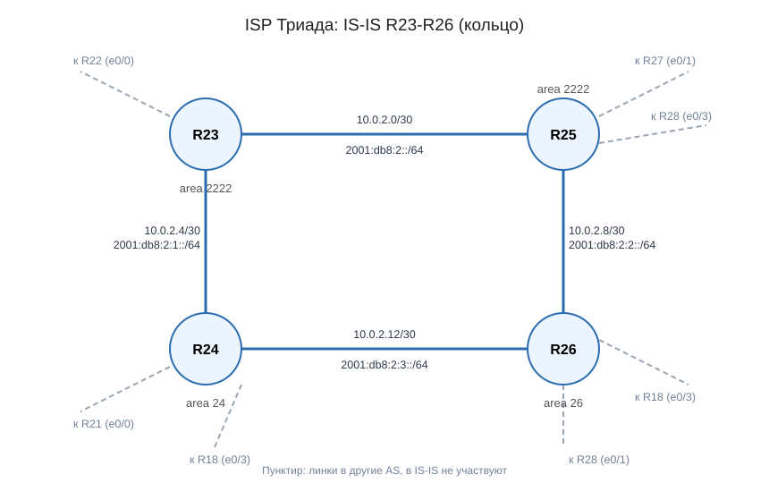

# IS-IS в ISP Триада



ISP Триада: AS с кольцом маршрутизаторов R23-R25-R26-R24-R23. Адресация линков и loopback взята из [работы 1](../1.%20Проектирование%20сети/README.md), IPv6-адреса на кольце я проставил в этой работе, до неё на Триаде был только IPv4. Линки наружу (R23 к R22, R24 к R21 и R18, R25 к R27 и R28, R26 к R28 и R18) смотрят в другие AS и в IS-IS не участвуют. Стенд: EVE-NG, лаба 2025-02.unl, роутеры IOL (образ L3-ADVENTERPRISE9-15.5.2T).

## 1. Задача и допущения

Требования задания:

1. R23 и R25 находятся в зоне 2222.
2. R24 находится в зоне 24.
3. R26 находится в зоне 26.
4. Настройка одновременно для IPv4 и IPv6.

Решения, которые я принял до работы со стендом:

- Имя процесса IS-IS на всех четырех: TRIADA.
- Структура NET по ISO 10589: AFI 49, адрес зоны, System ID ровно 6 байт, NSEL 00. Зоны из задания в NET ложатся так: 2222, 0024, 0026 (дописываю ноль до четного числа hex-разрядов, это вопрос записи, зона та же).
- В IS-IS включаю Loopback0 и четыре линка кольца. Внешние линки не включаю: они в другие AS, там другие протоколы, и задание про внутреннюю IGP Триады.
- is-type оставляю по умолчанию level-1-2. Тогда на линке R23-R25 (зона одна, 2222) поднимется level-1 соседство, а на линках между разными зонами только level-2: IS-IS не строит level-1 между разными зонами ([RFC 1195](https://www.rfc-editor.org/rfc/rfc1195)). Так и вышло, проверки в разделе 5.
- IPv6 включаю классикой для IOS: на интерфейсе `ip router isis TRIADA` и `ipv6 router isis TRIADA`, глобально `ipv6 unicast-routing` и `ipv6 cef`.

## 2. Адресация и NET

Кольцо (IPv6 проставлены в этой работе):

| Линк | IPv4 | IPv6 |
|---|---|---|
| R23 e0/1 - R25 e0/0 | 10.0.2.0/30 (R23=.1, R25=.2) | 2001:db8:2::/64 |
| R25 e0/2 - R26 e0/2 | 10.0.2.8/30 (R25=.1, R26=.2) | 2001:db8:2:2::/64 |
| R26 e0/0 - R24 e0/1 | 10.0.2.12/30 (R24=.1, R26=.2) | 2001:db8:2:3::/64 |
| R24 e0/2 - R23 e0/2 | 10.0.2.4/30 (R23=.1, R24=.2) | 2001:db8:2:1::/64 |

Loopback0: 10.0.0.23..26/32 и 2001:db8:0:23..26::1/128.

| Роутер | Зона | NET |
|---|---|---|
| R23 | 2222 | 49.2222.0000.0000.0023.00 |
| R25 | 2222 | 49.2222.0000.0000.0025.00 |
| R24 | 24 | 49.0024.0000.0000.0024.00 |
| R26 | 26 | 49.0026.0000.0000.0026.00 |

## 3. Конфигурация

Особенности образа IOL 15.5.2T, на которые я наткнулся:

- На интерфейсе команда `isis enable` отсутствует как класс: образ отвечает `% Invalid input`. Работает старый синтаксис `ip router isis` и `ipv6 router isis`.
- `ipv6 router isis` на интерфейсе без глобального `ipv6 unicast-routing` не принимается: `%ISIS: IPv6 unicast routing not enabled`.
- Порядок, который я выдерживал на всех роутерах: сначала создать процесс с валидным NET, потом поднимать интерфейсы.

R23 (полностью, остальным так же с другими адресами и NET):

```
ipv6 unicast-routing
ipv6 cef
router isis TRIADA
 net 49.2222.0000.0000.0023.00
!
interface Loopback0
 ip address 10.0.0.23 255.255.255.255
 ipv6 address 2001:db8:0:23::1/128
 ip router isis TRIADA
 ipv6 router isis TRIADA
interface Ethernet0/1
 ip address 10.0.2.1 255.255.255.252
 ipv6 address 2001:db8:2::1/64
 ip router isis TRIADA
 ipv6 router isis TRIADA
interface Ethernet0/2
 ip address 10.0.2.5 255.255.255.252
 ipv6 address 2001:db8:2:1::1/64
 ip router isis TRIADA
 ipv6 router isis TRIADA
```

R25: e0/0 (10.0.2.2, 2001:db8:2::2/64) и e0/2 (10.0.2.9, 2001:db8:2:2::1/64), loopback 10.0.0.25/32, NET 49.2222.0000.0000.0025.00.
R24: e0/1 (10.0.2.13, 2001:db8:2:3::1/64) и e0/2 (10.0.2.6, 2001:db8:2:1::2/64), loopback 10.0.0.24/32, NET 49.0024.0000.0000.0024.00.
R26: e0/0 (10.0.2.14, 2001:db8:2:3::2/64) и e0/2 (10.0.2.10, 2001:db8:2:2::2/64), loopback 10.0.0.26/32, NET 49.0026.0000.0000.0026.00.

Внешние линки (R23 e0/0, R24 e0/0 и e0/3, R25 e0/1 и e0/3, R26 e0/1 и e0/3) остались как в работе 1, без IPv6 и без IS-IS. Заодно снял тестовый Loopback100 (203.0.113.1), оставшийся на R25 от проверок PBR.

## 4. Зоны на роутерах

`show clns protocol` после настройки, NET ровно по одному, зоны совпадают с заданием:

```
R23: System Id: 0000.0000.0023.00  IS-Type: level-1-2  area: 49.2222
R25: System Id: 0000.0000.0025.00  IS-Type: level-1-2  area: 49.2222
R24: System Id: 0000.0000.0024.00  IS-Type: level-1-2  area: 49.0024
R26: System Id: 0000.0000.0026.00  IS-Type: level-1-2  area: 49.0026
```

## 5. Проверки

Соседи, R23. С R25 зона одна, поэтому два соседства: level-1 и level-2. С R24 зоны разные, только level-2:

```
R23#show isis neighbors

Tag TRIADA:
System Id      Type Interface   IP Address      State Holdtime Circuit Id
R24            L2   Et0/2       10.0.2.6        UP    7        R24.02
R25            L1   Et0/1       10.0.2.2        UP    9        R25.01
R25            L2   Et0/1       10.0.2.2        UP    7        R25.01
```

R24: R23 L2 (Et0/2), R26 L2 (Et0/1). R25: R23 L1+L2 (Et0/0), R26 L2 (Et0/2). R26: R24 L2 (Et0/0), R25 L2 (Et0/2). Кольцо замкнуто, все соседства UP.

`show isis topology` на R23: R25 виден и в level-1, и в level-2; R24 и R26 только в level-2; до R26 две равные ветки по метрике 20, то есть ECMP в обе стороны кольца:

```
paths to level-1 routers
R25                  10         R25                  Et0/1
paths to level-2 routers
R24                  10         R24                  Et0/2
R25                  10         R25                  Et0/1
R26                  20         R24                  Et0/2
                                R25                  Et0/1
```

Таблица IPv4 на R23: сети R25 пришли как L1, остальное как L2, к 10.0.0.26/32 два равноценных пути:

```
R23#show ip route isis
i L2     10.0.0.24/32 [115/20] via 10.0.2.6, Ethernet0/2
i L1     10.0.0.25/32 [115/20] via 10.0.2.2, Ethernet0/1
i L2     10.0.0.26/32 [115/30] via 10.0.2.6, Ethernet0/2
                      [115/30] via 10.0.2.2, Ethernet0/1
i L1     10.0.2.8/30 [115/20] via 10.0.2.2, Ethernet0/1
i L2     10.0.2.12/30 [115/20] via 10.0.2.6, Ethernet0/2
```

В IPv6-таблице те же префиксы: коды I1/I2 соответствуют level-1/level-2, административная distance у IS-IS в обеих таблицах 115:

```
R23#show ipv6 route isis
I2  2001:DB8:0:24::1/128 [115/20] via FE80::A8BB:CCFF:FE01:8020, Ethernet0/2
I1  2001:DB8:0:25::1/128 [115/20] via FE80::A8BB:CCFF:FE01:9000, Ethernet0/1
I2  2001:DB8:0:26::1/128 [115/30] via FE80::A8BB:CCFF:FE01:9000, Ethernet0/1
                                via FE80::A8BB:CCFF:FE01:8020, Ethernet0/2
I1  2001:DB8:2:2::/64 [115/20] via FE80::A8BB:CCFF:FE01:9000, Ethernet0/1
I2  2001:DB8:2:3::/64 [115/20] via FE80::A8BB:CCFF:FE01:8020, Ethernet0/2
```

Пинги loopback c R23 (источник мой loopback, IPv4 и IPv6, транзитом через L1 и через L2):

```
ping 10.0.0.26                 -> 5/5
ping 2001:db8:0:26::1          -> 5/5
ping 10.0.0.24 source 10.0.0.23   -> 5/5
ping 2001:db8:0:24::1 source Loopback0 -> 5/5
```

С R26 в сторону R23 тоже проверил: `ping 2001:db8:0:23::1` с R26 5/5.

## 6. Что оказалось неочевидным

- Длина NET критична. Я сначала задал NET 49.2222.0000.0023.00: он короче, чем нужно, AFI, зона, System ID ровно 6 байт и NSEL в него не влезают. Образ такой NET принял и процесс поднялся, что меня обмануло: IOS сдвинул разбор, System ID стал 2222.0000.0023, а от зоны остался только голый 49. Level-2 соседства с таким NET работают (level-2 зоны не сверяет), пинги проходят, а роутер при этом стоит не в той зоне, что требует задание, и level-1 соседство с R25 не поднимается. Поймал я это через `debug isis adj-packets`: в логе `Area mismatch, level 1 IIH` и source ID из L1 hello у R23 был 2222.0000.0023 вместо 0000.0000.0023.
- `net` в процессе, где NET уже есть, не заменяет его, а добавляет зону. Сменить System ID нельзя: IOS отвечает `%CLNS: System ID (2222.0000.0023.00) must not change when defining additional area addresses`. Правильная последовательность: `no net <старый>`, потом `net <новый>`.
- Битый NET пережил пару рестартов ноды: он сидел в nvram, поэтому возвращался в running-config. Перед финальной проверкой я сверил `show running-config | include net` на всех четырех: ровно по одному NET, все валидной длины.
- Консоль R23 на этом стенде периодически переставала отдавать вывод: сессия есть, экран пустой. Лечилось рестартом ноды через API EVE-NG. Чтобы не терять работу по чуть-чуть, конфиг на R23 я заливал тремя кусками (IPv4-база, IPv6-адреса, IS-IS) с `write memory` после каждого.
- Смена System ID (после замены NET) обрушила на полминуты все SPF: LSP перегенерируются заново, в этот момент пинги теряются. Это ожидаемое поведение, через 30-40 секунд все сходится.

## 7. Откат

По роутеру: `no router isis TRIADA`, на интерфейсах кольца `no ip router isis`, `no ipv6 router isis`, снять добавленные ipv6-адреса, `no ipv6 unicast-routing`, `no ipv6 cef`. IPv4-адресация кольца из работы 1 не менялась, откат IS-IS на нее не влияет.

## 8. Соответствие требованиям

| Требование | Как закрыто | Проверка |
|---|---|---|
| R23 и R25 в зоне 2222 | NET 49.2222.0000.0000.0023.00 / ...0025.00 | `show clns protocol`: area 49.2222 |
| R24 в зоне 24 | NET 49.0024.0000.0000.0024.00 | `show clns protocol`: area 49.0024 |
| R26 в зоне 26 | NET 49.0026.0000.0000.0026.00 | `show clns protocol`: area 49.0026 |
| IPv4 и IPv6 одновременно | `ip router isis` + `ipv6 router isis` на петлевых и линках кольца | `show ip route isis` и `show ipv6 route isis`, пинги обоих стеков 5/5 |

Конфигурации сохранены на всех четырех роутерах (`write memory`).

## Источники

- [ISO/IEC 10589](https://www.iso.org/standard/70783.html) структура NET: AFI, зоны, System ID 6 байт, NSEL.
- [RFC 1195](https://www.rfc-editor.org/rfc/rfc1195) использование IS-IS для IPv4 и IPv6, поведение level-1 между зонами.
- [RFC 5308](https://www.rfc-editor.org/rfc/rfc5308) IPv6-адреса в IS-IS LSP.
- [RFC 5302](https://www.rfc-editor.org/rfc/rfc5302) обзор IS-IS для dual-stack (IPv4 и IPv6): уровни level-1/level-2, почему соседство между разными зонами возможно только на level-2.
- Cisco IOS IPv6 Configuration Guide, chapter Configuring IS-IS for IPv6 (синтаксис ipv6 router isis).
