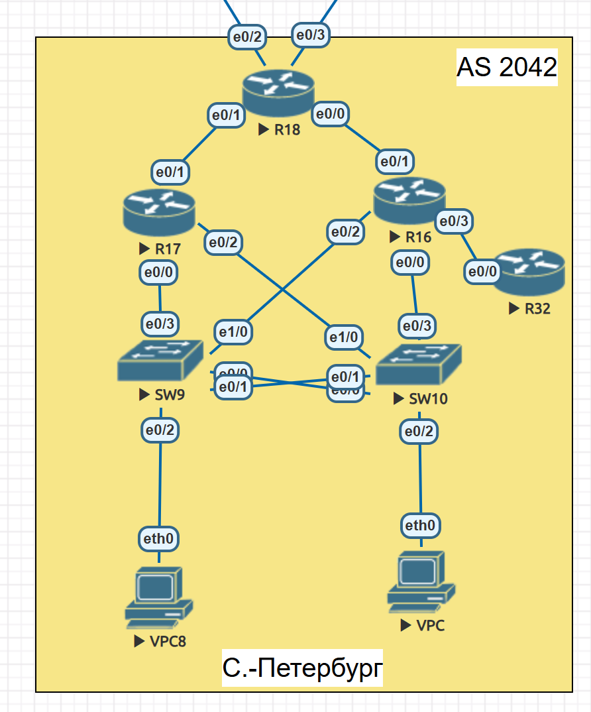

# EIGRP named-mode в офисе Санкт-Петербург



Офис Санкт-Петербурга из [работы 1](../1.%20Проектирование%20сети/README.md): пара шлюзов R16 и R17 с HSRP над VLAN 10, 20 и 99, коммутаторы SW9 и SW10, выход из офиса через R18 в ядро (линки к R24 и R26) и отдельный роутер R32 на линке 10.0.3.8/30 от R16. Площадка лежит в 10.12.0.0/16, P2P-блок офиса 10.0.3.0/24, номер AS 2042. Стенд: EVE-NG, лаба 2025-02.unl, роутеры IOL (образ L3-ADVENTERPRISE9-15.5.2T).

## 1. Задача и допущения

Требования задания:

1. В офисе С.-Петербург настроить EIGRP.
2. R32 получает только маршрут по умолчанию.
3. R16 и R17 анонсируют только суммарные префиксы.
4. Настройка через EIGRP named-mode.
5. Настройка одновременно для IPv4 и IPv6.

Решения, которые я принял до работы со стендом:

- Один именованный процесс SPB с двумя address-family: ipv4 и ipv6, номер AS 2042 из работы 1.
- IPv6 офису проставил в этой работе, до неё в схеме офиса был только IPv4. Всю площадку положил в один префикс 2001:db8:2042::/48 (2001:db8::/32 зарезервирован под документацию, [RFC 3849](https://www.rfc-editor.org/rfc/rfc3849)): VLAN-сети идут как `:10::/64`, `:20::/64`, `:99::/64`, P2P как `:100::/64`, `:101::/64`, `:102::/64`, петлевые /128 по номеру роутера. Тогда наружу из офиса уходит один IPv6-суммар.
- Суммирую на интерфейсах, которыми офис граничит с R18: это R16 e0/1 и R17 e0/1.
- Маршрут по умолчанию для R32 делаю суммаром `0.0.0.0/0` и `::/0` на интерфейсе R16 e0/3, а на самом R32 включаю `eigrp stub connected`.
- Петлевые IPv4 не агрегирую, остаются /32. Петлевые офисных роутеров сидят в общем пуле 10.0.0.0/24 вместе с петлевыми других площадок, поэтому любой суммар, который их накрывает (например /28), заявлял бы чужие адреса. С петлевыми IPv6 отдельного решения нет: они лежат внутри офисного /48 и накрываются суммаром 2001:db8:2042::/48, как описано в разделе 4.
- HSRP для IPv6 не добавлял: IPv6-шлюза в работах 1-3 не было, а адреса на SVI нужны для соседства EIGRP и проверок. Последствие видно в разделе 5: IPv6 у хостов есть (SLAAC), а виртуального IPv6-адреса шлюза нет ни у кого, поэтому 2001:db8:2042:10::1 не отвечает.

## 2. Адресация офиса

Петлевые: 10.0.0.16/32, 10.0.0.17/32, 10.0.0.18/32, 10.0.0.32/32 и 2001:db8:2042:16::1/128, :17::1/128, :18::1/128, :32::1/128.

P2P-линки (правая колонка IPv4 из работы 1, IPv6 проставлен здесь):

| Линк | IPv4 | IPv6 |
|---|---|---|
| R16 e0/1 - R18 e0/0 | 10.0.3.0/30 (R16=.1, R18=.2) | `2001:db8:2042:100::/64` (::1, ::2) |
| R17 e0/1 - R18 e0/1 | 10.0.3.4/30 (R17=.5, R18=.6) | `2001:db8:2042:101::/64` (::5, ::6) |
| R16 e0/3 - R32 e0/0 | 10.0.3.8/30 (R16=.9, R32=.10) | `2001:db8:2042:102::/64` (::9, ::10) |

VLAN площадки, виртуальный адрес `.1`, основной роутер R17 `.2`, резервный R16 `.3` (HSRP v2, как в работе 1):

| VLAN | IPv4 | IPv6 |
|---|---|---|
| 10 | 10.12.10.0/24 | `2001:db8:2042:10::/64` |
| 20 | 10.12.20.0/24 | `2001:db8:2042:20::/64` |
| 99 | 10.12.99.0/24 | `2001:db8:2042:99::/64` |

Соседство EIGRP между R16 и R17 идёт по VLAN 99, той же управляющей сети площадки, в которой живёт HSRP, и в обоих address-family.

Хосты на площадке: VPC8 в VLAN 10 это 10.12.10.10/24 со шлюзом 10.12.10.1 (порт SW9 e0/2), VPC в VLAN 20 это 10.12.20.10/24 со шлюзом 10.12.20.1 (порт SW10 e0/2). IPv4 у обоих прописан в стартовом файле VPCS, IPv6 хосты получили сами по SLAAC, когда на SVI появились адреса и включённая отправка RA.

## 3. Конфигурация

Что показала именованная модель на этом образе:

- Процесс заводится по имени (`router eigrp SPB`), AS указывается внутри address-family. Обе таблицы, IPv4 и IPv6, живут в одном процессе.
- В IPv6 address-family команды `network` нет вообще, образ её не показывает в подсказке. Интерфейс в IPv6-AF включается через `af-interface <интерфейс>` и `no passive-interface`. Поэтому в IPv4-AF я оставил `network`-строки, а в IPv6-AF работаю только af-interface.
- Пассивный режим включён наоборот: `af-interface default` с `passive-interface`, и поверх `no passive-interface` на нужных интерфейсах. Так в процесс не залетают линки R18 в ядро (e0/2 и e0/3), где EIGRP быть не должно.
- IPv6-AF не поднимается без глобального `ipv6 unicast-routing`, я включил ещё и `ipv6 cef`.
- `summary-address` живёт в `af-interface` и разная в двух AF: в IPv4 это `summary-address 10.12.0.0 255.255.0.0`, в IPv6 `summary-address 2001:DB8:2042::/48`. Привычного ключа `distance` у неё в этом образе нет.
- `default-information-originate` в address-family нет, `distribute-list` есть только в `topology base` и действует на весь AF целиком, то есть не даёт отсеять что-то на одном интерфейсе.
- `eigrp stub` доступен внутри AF, я применил `eigrp stub connected`.

Уровень интерфейсов: VLAN 20 я перенёс на подынтерфейс Ethernet0/2.20 (до работы он сидел на Ethernet0/1.20), а Ethernet0/3 на R16 поднял под линк к R32. Ethernet0/2 на обоих роутерах и Ethernet0/3 на R16 до работы были в `shutdown`, сейчас подняты; физические Ethernet0/2 при этом без адреса (`no ip address`).

```
! R16
interface Ethernet0/3
 description to R32 e0/0
 ip address 10.0.3.9 255.255.255.252
 ipv6 address 2001:DB8:2042:102::9/64
!
interface Ethernet0/2.20
 encapsulation dot1Q 20
 ip address 10.12.20.3 255.255.255.0
 standby version 2
 standby 20 ip 10.12.20.1
 ipv6 address 2001:DB8:2042:20::3/64

! R17
interface Ethernet0/2.20
 encapsulation dot1Q 20
 ip address 10.12.20.2 255.255.255.0
 standby version 2
 standby 20 ip 10.12.20.1
 standby 20 priority 110
 standby 20 preempt
 ipv6 address 2001:DB8:2042:20::2/64
```

Снято командами `show run interface Ethernet0/3`, `Ethernet0/2.20` и `Ethernet0/2` на R16 и R17, три блока выше; `show run interface Ethernet0/2` на обоих даёт ровно `no ip address`.

R16 полностью, он суммирующий и в сторону R18, и в сторону R32:

```
router eigrp SPB
 !
 address-family ipv4 unicast autonomous-system 2042
  !
  af-interface default
   passive-interface
  exit-af-interface
  !
  af-interface Ethernet0/1
   summary-address 10.0.3.0 255.255.255.0
   summary-address 10.12.0.0 255.255.0.0
   no passive-interface
  exit-af-interface
  !
  af-interface Ethernet0/3
   summary-address 0.0.0.0 0.0.0.0
   no passive-interface
  exit-af-interface
  !
  af-interface Ethernet0/0.99
   no passive-interface
  exit-af-interface
  !
  topology base
  exit-af-topology
  network 10.0.0.16 0.0.0.0
  network 10.0.3.0 0.0.0.3
  network 10.0.3.8 0.0.0.3
  network 10.12.0.0 0.0.255.255
  eigrp router-id 10.0.0.16
 exit-address-family
 !
 address-family ipv6 unicast autonomous-system 2042
  !
  af-interface default
   passive-interface
  exit-af-interface
  !
  af-interface Ethernet0/1
   summary-address 2001:DB8:2042::/48
   no passive-interface
  exit-af-interface
  !
  af-interface Ethernet0/3
   summary-address ::/0
   no passive-interface
  exit-af-interface
  !
  af-interface Ethernet0/0.99
   no passive-interface
  exit-af-interface
  !
  topology base
  exit-af-topology
  eigrp router-id 10.0.0.16
 exit-address-family
```

R17 повторяет R16: те же `af-interface Ethernet0/1` с двумя IPv4-суммарами и IPv6-суммаром, но e0/1 смотрит на R18 через 10.0.3.4/30, линка на R32 у него нет, поэтому `af-interface Ethernet0/3` отсутствует и маршрут по умолчанию R17 не объявляет. `network`-строки: 10.0.0.17/32, 10.0.3.4/30, 10.12.0.0/16.

```
router eigrp SPB
 !
 address-family ipv4 unicast autonomous-system 2042
  af-interface default
   passive-interface
  exit-af-interface
  af-interface Ethernet0/1
   summary-address 10.0.3.0 255.255.255.0
   summary-address 10.12.0.0 255.255.0.0
   no passive-interface
  exit-af-interface
  af-interface Ethernet0/0.99
   no passive-interface
  exit-af-interface
  topology base
  exit-af-topology
  network 10.0.0.17 0.0.0.0
  network 10.0.3.4 0.0.0.3
  network 10.12.0.0 0.0.255.255
  eigrp router-id 10.0.0.17
 exit-address-family
 !
 address-family ipv6 unicast autonomous-system 2042
  af-interface default
   passive-interface
  exit-af-interface
  af-interface Ethernet0/1
   summary-address 2001:DB8:2042::/48
   no passive-interface
  exit-af-interface
  af-interface Ethernet0/0.99
   no passive-interface
  exit-af-interface
  topology base
  exit-af-topology
  eigrp router-id 10.0.0.17
 exit-address-family
```

R18 принимает офис, сам ничего не суммирует, в процесс включены e0/0, e0/1 и петлевой:

```
router eigrp SPB
 !
 address-family ipv4 unicast autonomous-system 2042
  af-interface default
   passive-interface
  exit-af-interface
  af-interface Ethernet0/0
   no passive-interface
  exit-af-interface
  af-interface Ethernet0/1
   no passive-interface
  exit-af-interface
  topology base
  exit-af-topology
  network 10.0.0.18 0.0.0.0
  network 10.0.3.0 0.0.0.3
  network 10.0.3.4 0.0.0.3
  eigrp router-id 10.0.0.18
 exit-address-family
 !
 address-family ipv6 unicast autonomous-system 2042
  af-interface default
   passive-interface
  exit-af-interface
  af-interface Ethernet0/0
   no passive-interface
  exit-af-interface
  af-interface Ethernet0/1
   no passive-interface
  exit-af-interface
  topology base
  exit-af-topology
  eigrp router-id 10.0.0.18
 exit-address-family
```

R32: один рабочий интерфейс e0/0, в обоих AF добавлен `eigrp stub connected`:

```
router eigrp SPB
 !
 address-family ipv4 unicast autonomous-system 2042
  af-interface default
   passive-interface
  exit-af-interface
  af-interface Ethernet0/0
   no passive-interface
  exit-af-interface
  topology base
  exit-af-topology
  network 10.0.0.32 0.0.0.0
  network 10.0.3.8 0.0.0.3
  eigrp router-id 10.0.0.32
  eigrp stub connected
 exit-address-family
 !
 address-family ipv6 unicast autonomous-system 2042
  af-interface default
   passive-interface
  exit-af-interface
  af-interface Ethernet0/0
   no passive-interface
  exit-af-interface
  topology base
  exit-af-topology
  eigrp router-id 10.0.0.32
  eigrp stub connected
 exit-address-family
```

## 4. Суммары и маршрут по умолчанию

На R16 e0/1 и R17 e0/1 объявлены три суммара: 10.12.0.0/16, 10.0.3.0/24 и 2001:db8:2042::/48. `summary-address` в EIGRP делает две вещи сразу: объявляет агрегат и не выпускает наружу более конкретные префиксы этого интерфейса. Поэтому R18 видит ровно два IPv4-агрегата и один IPv6, а не 10.12.10.0/24, 10.12.20.0/24, 10.12.99.0/24 и /30-линики по отдельности.

Разница между стеками в петлевых адресах. В IPv4 петлевые 10.0.0.16/32, 10.0.0.17/32 и 10.0.0.32/32 лежат вне обоих суммаров (пул 10.0.0.0/24), поэтому они доходят до R18 отдельными записями. В IPv6 петлевые внутри 2001:db8:2042::/48, и суммар их накрывает: у R18 в IPv6-таблице ровно одна запись на весь офис.

Петлевые при этом пассивны, отдельного `af-interface Loopback0` в конфиге нет и не нужно: `af-interface default` с `passive-interface` закрывает и Loopback0, а пассивный интерфейс в EIGRP только не отправляет hello, свою сеть он анонсирует как обычно. Именно поэтому 10.0.0.16/32, 10.0.0.17/32 и 10.0.0.32/32 видны у R18 отдельными записями, хотя соседства на петлевом нет.

Маршрут по умолчанию для R32 сделан тем же механизмом: на R16 e0/3 висят `summary-address 0.0.0.0 0.0.0.0` и `summary-address ::/0`. На самом R16 этот агрегат превращается в локальную запись в Null0 с administrative distance 5, то есть R16 сам считает себя последним рубильником:

```
R16#show ip route 0.0.0.0
Routing entry for 0.0.0.0/0, supernet
  Known via "eigrp 2042", distance 5, metric 1280, candidate default path, type internal
  ...
  * directly connected, via Null0
```

`eigrp stub connected` на R32 нужен не для того, чтобы R32 получил только default. Я это проверил экспериментом (раздел 5): я снял суммар на R16, и R32, оставаясь stub, принял всю внутреннюю таблицу офиса. Stub делает другое: он объявляет соседям, что у него только connected, поэтому R16 и R17 не гоняют по нему сборщики queries при потере маршрута, и R32 не становится транзитом между офисом и чем-то ещё. Петлевой адрес R32 при этом остаётся видимым: `stub connected` его анонсирует, 10.0.0.32/32 лежит в таблицах R16, R17 и R18. В IPv6 у R18 петлевого R32 отдельной записью нет, его накрывает суммар /48.

## 5. Проверки

Соседи на R16, IPv4 и IPv6, три интерфейса, в IPv6 соседи видны по link-local:

```
R16#show eigrp address-family ipv4 neighbors
2   10.0.3.10               Et0/3                    13 00:07:36
1   10.12.99.2              Et0/0.99                 13 00:07:37
0   10.0.3.2                Et0/1                    11 00:17:50
```

R17: 10.12.99.3 (Et0/0.99) и 10.0.3.6 (Et0/1). R18: 10.0.3.1 (Et0/0) и 10.0.3.5 (Et0/1). R32: 10.0.3.9 (Et0/0), по одному соседу в обоих AF.

R18, принятое от офиса. Ровно суммары, каждый двумя равными ветками через R16 и R17 (ECMP 90/1536000):

```
R18#show ip route eigrp
D        10.0.0.16/32 [90/1024640] via 10.0.3.1
D        10.0.0.17/32 [90/1024640] via 10.0.3.5
D        10.0.0.32/32 [90/1536640] via 10.0.3.1
D        10.0.3.0/24 [90/1536000] via 10.0.3.5
                     [90/1536000] via 10.0.3.1
D        10.12.0.0/16 [90/1536000] via 10.0.3.5
                      [90/1536000] via 10.0.3.1

R18#show ipv6 route eigrp
D   2001:DB8:2042::/48 [90/1024640]
     via FE80::A8BB:CCFF:FE01:10, Ethernet0/0
     via FE80::A8BB:CCFF:FE01:1010, Ethernet0/1
```

R32, вся таблица: только маршрут по умолчанию и свои connected.

```
R32#show ip route
Gateway of last resort is 10.0.3.9 to network 0.0.0.0
D*    0.0.0.0/0 [90/1024640] via 10.0.3.9, 00:09:47, Ethernet0/0
      10.0.0.0/8 is variably subnetted, 3 subnets, 2 masks
C        10.0.0.32/32 is directly connected, Loopback0
C        10.0.3.8/30 is directly connected, Ethernet0/0
L        10.0.3.10/32 is directly connected, Ethernet0/0

R32#show ipv6 route
D   ::/0 [90/1024640]
     via FE80::A8BB:CCFF:FE01:30, Ethernet0/0
```

Эксперимент с суммаром. Снял на R16 e0/3 `summary-address 0.0.0.0 0.0.0.0`, подождал, снял таблицу R32:

```
R32#show ip route eigrp
Gateway of last resort is not set
D        10.0.0.16/32 [90/1024640] via 10.0.3.9
D        10.0.0.17/32 [90/1536640] via 10.0.3.9
D        10.0.0.18/32 [90/1536640] via 10.0.3.9
D        10.0.3.0/30 [90/1536000] via 10.0.3.9
D        10.0.3.4/30 [90/2048000] via 10.0.3.9
D        10.12.10.0/24 [90/1536000] via 10.0.3.9
D        10.12.20.0/24 [90/1536000] via 10.0.3.9
D        10.12.99.0/24 [90/1536000] via 10.0.3.9
```

Восемь конкретных префиксов вместо одного дефолта, и самого дефолта нет. Вернул суммар, R32 вернулся к одной записи. Вывод: "только default" на R32 обеспечивает `summary-address` на R16, а не `eigrp stub`.

Пинги, по 5 пакетов в каждой серии:

| Откуда | Куда | Результат |
|---|---|---|
| R18 | 2001:db8:2042:16::1, :17::1, :32::1 | 5/5, 5/5, 5/5 |
| R18 | 10.0.0.32, 10.0.3.10, 10.12.10.1 | 5/5, 5/5, 5/5 |
| R32 | 10.0.0.17, 2001:db8:2042:17::1, 10.12.10.1 | 5/5, 5/5, 5/5 |
| R17 | 10.0.3.10, 2001:db8:2042:32::1 | 5/5, 5/5 |
| R16 | 2001:db8:2042:17::1, 2001:db8:2042:10::2, 10.12.20.2 | 5/5, 5/5, 5/5 |
| VPC8, 10.12.10.10 | 10.12.10.1, 10.12.10.2, 10.12.10.3, 10.0.0.16, 10.0.0.32, 10.0.0.18 | 5/5 в каждой из шести серий |
| VPC, 10.12.20.10 | 10.12.20.1, 10.12.20.2, 10.12.20.3, 10.0.0.17, 10.0.0.32 | 5/5 в каждой из пяти серий |
| VPC8 | 2001:db8:2042:16::1, 2001:db8:2042:32::1 | 5/5, 5/5 |
| VPC | 2001:db8:2042:17::1, 2001:db8:2042:32::1 | 5/5, 5/5 |

R18 пингует петлевые офиса и виртуальный адрес шлюза 10.12.10.1, находясь за двумя суммарами, R32 с одной записью в таблице пингует R17 в оба стека, а R16 достает SVI R17 в VLAN 20 через перенесённый порт e0/2. Первую серию в 10.12.20.2 я снял отдельно, сразу после `clear arp-cache`: те же 5/5 и min/avg/max 1/2/3 мс, на разрешении MAC-адреса пакет не теряется.

Последние четыре строки таблицы сняты с самих хостов, а не с роутеров; VPCS шлёт пакеты с 56-байтным payload, в выводе это строки `84 bytes from ...`. VPC8 сидит в VLAN 10, VPC в VLAN 20, IPv4 у обоих из стартового файла VPCS, IPv6 получен по SLAAC. Хост VLAN 20 пингует свой виртуальный шлюз 5/5, то есть перенесённый на штатный порт Ethernet0/2.20 работает и группа 20 договаривается. Петлевой адрес R32 оба хоста достают в обоих стеках: 10.0.0.32 отвечает с ttl=254, а 2001:db8:2042:32::1 с hop limit 63, то есть ответ шёл через R16, а не по L2. Заодно это самая прямая проверка требования про суммары: у шлюзов маршрут к R32 есть из EIGRP, а у R18 в IPv6 лежит один агрегат вместо четырёх петлевых записей.

HSRP после переноса VLAN 20 на штатный порт не разъехался: на R16 все три группы в Standby, active у 10.12.10.2, 10.12.20.2, 10.12.99.2, то есть R17 со своим приоритетом 110 держит шлюзы, как и в работе 1.

## 6. Что оказалось неочевидным

- Порт VLAN 20 на стенде был не тот, и на обоих роутерах. Саб-интерфейсы Ethernet0/1.20 с адресами 10.12.20.3 и 10.12.20.2 и группой HSRP 20 висели на портах, которые смотрят в R18, а Ethernet0/2, которыми по работе 1 VLAN 20 идёт на SW9 и SW10, были в shutdown. На линке до R18 VLAN 20 быть не может: R18 e0/0 это routed-порт 10.0.3.2/30, транка там нет, группе 20 не с кем было договариваться. Перенёс саб-интерфейсы на Ethernet0/2.20 на обоих роутерах, как в работе 1 (R16 e0/2 - SW9 e1/0, R17 e0/2 - SW10 e1/0), после чего группа 20 встала: на R16 Et0/2.20 в Standby, active 10.12.20.2.
- Линк R16 e0/3 к R32 был без адреса и в выключенном состоянии, хотя в работе 1 он спроектирован и отдан под 10.0.3.8/30. Поднял и адресовал в обоих стеках, иначе требование про R32 негде проверять.
- Маршрут по умолчанию здесь делает именно `summary-address 0.0.0.0 0.0.0.0`, а не то, что я изначально предполагал. `default-information-originate` в address-family отсутствует, а `distribute-list` доступен только глобально для AF, поэтому отсечь конкретные префиксы на одном интерфейсе к R32 нечем.
- Тот же суммар на R16 даёт ему собственную запись `D* 0.0.0.0/0` в Null0 с distance 5 и флагом candidate default path. Понизить ей distance нельзя, ключа `distance` у `summary-address` в этом образе нет. На практике это означает, что на R16 дефолт в Null0 всегда конкретнее любого выученного маршрута, и если офисная сеть перестанет быть ему известна детальнее, трафик уйдёт в дыру, а не по дефолту куда-то ещё.
- Сумма в Null0 съедает всё, что роутер не знает детальнее, и я это поймал на R17. Соседства R16 и R17 изначально не было: пассивный режим по умолчанию оставил в процессе только линки на R18 и на R32, и роутеры остались парой HSRP без EIGRP. В таком виде у R17 в таблице висит `10.0.3.0/24 is a summary, Null0`, а сам линк 10.0.3.8/30 до R32 ей накрывается и при этом ниоткуда не известен: R18 получает от R16 уже суммар /24 и детальнее /30 не раздаёт. Пакет R17 до 10.0.3.10 совпадает с этой суммой и уходит в Null0. В логе это состояние снято до правки, сосед у R17 один (10.0.3.6), записи 10.0.3.8/30 нет. Починка: `no passive-interface` на Ethernet0/0.99 в обоих address-family, после чего у R17 появляется 10.0.3.8/30 через 10.12.99.3 и пинг до R32 проходит 5/5. По аптайду соседей на R16 это видно: Et0/1 держит соседство 00:17:50, Et0/0.99 00:07:37, то есть соседство по VLAN 99 появилось на десять минут позже.
- Маршрут по умолчанию настраивается отдельно в каждом address-family. На одном из промежуточных этапов R32 пинговал IPv4-адреса офиса 5/5, а оба IPv6-адреса возвращали 0/5: на R16 к тому моменту висел только `summary-address 0.0.0.0 0.0.0.0`, IPv6-дефолт `::/0` в IPv6-AF никто не объявлял.
- 2001:db8:2042:10::1 не отвечает, и со стороны это похоже на поломку маршрутизации. С R18 этот адрес даёт 0/2, хост VPC8 на него получает `host (2001:db8:2042:10::1) not reachable`, при этом соседний 2001:db8:2042:10::2 и петлевые офиса пингуются 5/5. Причина не в EIGRP: HSRP в работах 1-3 был только для IPv4, и адрес `.1` в IPv6 никто не держит, хотя хосты в IPv6 уже есть и адреса получили по SLAAC.
- `eigrp stub` не ограничивает то, что stub-роутер принимает. Ожидал обратного, эксперимент показал: без суммара R32 со `stub connected` принял всю внутреннюю таблицу. Ограничение анонсов в мою сторону и приём только дефолта, это две разные настройки, и живут они на R16.
- GUI-консоль EVE-NG на этом стенде не принимает ни вставку текста, ни Enter извне, поэтому конфиги я заливал через telnet-порты консолей, которые EVE-NG отдаёт наружу (R16 32784, R17 32785, R18 32786, R32 32800), построчно, с паузой между строками.

## 7. Откат

По роутеру: `no router eigrp SPB` убирает обе таблицы разом, вместе с Null0-суммарами. Дальше на интерфейсах снять `ipv6 address ...`, глобально `no ipv6 unicast-routing` и `no ipv6 cef`, если IPv6 больше нигде не нужен. На R16 и R17 вернуть VLAN 20 на Ethernet0/1.20 и `shutdown` на Ethernet0/2.20, если возвращать состояние стенда до работы; Ethernet0/3 на R16 можно вернуть в `shutdown` и снять с него 10.0.3.9. IPv4-адресация офиса из работы 1 при этом не менялась, откат EIGRP на неё не влияет, кроме R16 e0/3, где адрес я добавлял.

## 8. Соответствие требованиям

| Требование | Как закрыто | Проверка |
|---|---|---|
| EIGRP в офисе СПб | именованный процесс SPB, AS 2042, на R16, R17, R18, R32 | соседи на всех четырёх, см. раздел 5 |
| Named-mode | `router eigrp SPB` с двумя address-family вместо `router eigrp 2042` | `show eigrp address-family ...` выводит `VR(SPB) ... AS(2042)` |
| IPv4 и IPv6 одновременно | два AF в одном процессе, IPv6-адресация всей площадки | соседства и пинги в обоих AF, таблицы `show ip route` и `show ipv6 route`, хосты VPCS пингуют петлевые офиса в обоих стеках |
| R16 и R17 анонсируют только суммары | `summary-address` 10.12.0.0/16, 10.0.3.0/24, 2001:db8:2042::/48 на e0/1 обоих | у R18 ровно эти агрегаты, конкретных VLAN-подсетей и /30 нет |
| R32 получает только маршрут по умолчанию | `summary-address 0.0.0.0 0.0.0.0` и `::/0` на R16 e0/3, на R32 `eigrp stub connected` | вся таблица R32: `D* 0.0.0.0/0`, `D ::/0` и свои connected; эксперимент со снятым суммаром |

Конфигурации сохранены на четырёх роутерах: `write memory` везде отработал с `[OK]`, и все четыре выгружены из EVE-NG через Export CFG. Конфигурации роутеров в работе не привожу отдельными файлами, нужные куски running-config процитированы в разделах 2, 3 и 5.

## Источники

- [RFC 7868](https://www.rfc-editor.org/rfc/rfc7868) описание EIGRP: пакеты, TLV, работа DUAL, поведение суммаров и stub-роутеров.
- [RFC 3849](https://www.rfc-editor.org/rfc/rfc3849) префикс 2001:db8::/32 для документации, в нём вся IPv6-адресация офиса.
- [RFC 4291](https://www.rfc-editor.org/rfc/rfc4291) адресация IPv6, зачем петлевые /128 и почему агрегат накрывает петлевые внутри /48.
- Cisco IOS IP Routing: EIGRP Configuration Guide, главы Configuring EIGRP Named Mode, Configuring EIGRP Stub Routers, Summary Address Configuration.
