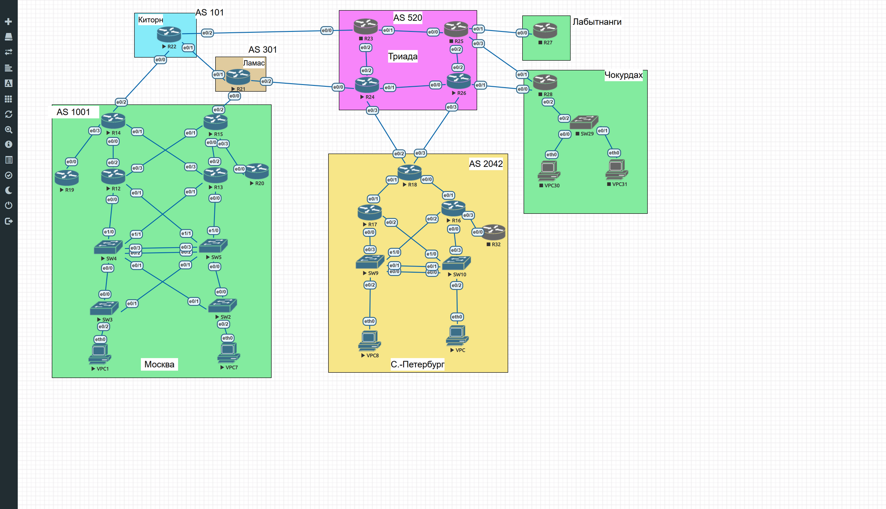

# eBGP между офисами и провайдерами



Пять автономных систем лаборатории из [работы 1](../1.%20Проектирование%20сети/README.md): офис Москва (AS1001, пограничные R14 и R15), провайдеры Киторн (AS101, R22) и Ламас (AS301, R21), провайдер Триада (AS520, R24 и R26) и офис С.-Петербург (AS2042, пограничный R18). Стенд: EVE-NG 6.2.0.4-Community, лаба 2025-02.unl, роутеры IOL L3-ADVENTERPRISEK9 15.5.2T. Ключевые выводы `show` цитирую прямо по тексту разделов; полный сырой лог консолей храню отдельно и в репозиторий не кладу.

## 1. Задача и допущения

Требования задания:

1. Настроить eBGP между офисом Москва и провайдерами Киторн и Ламас.
2. Настроить eBGP между Киторн и Ламас.
3. Настроить eBGP между Ламас и Триада.
4. Настроить eBGP между офисом С.-Петербург и Триада.
5. Организовать IP-доступность между пограничными роутерами офисов Москва и С.-Петербург.

Решения, которые я принял до работы со стендом:

- Сессии — по прямым линкам на адреса интерфейсов из плана работы 1. Преподаватель на консультации 28 предупреждал, что все спотыкаются про ebgp-multihop, но он нужен только сессиям, которые строятся через loopback или промежуточный L2; у нас все соседи напрямую, по умолчанию TTL=1 хватает. `bgp router-id` при этом по Loopback0 — идентификатор процесса не зависит от состояния физических портов.
- Анонсы: каждый роутер анонсирует свой лупбэк /32, Москва дополнительно `10.11.0.0/16`, СПб — `10.12.0.0/16`. Команда `network` требует точного совпадения с RIB, и обе суммарии там уже лежат: московская — сводка `area 10 range` из OSPF (работа 3), петербургская — суммар EIGRP с интерфейсов R16/R17 (работа 5). Отдавать провайдерам один агрегат на офис вместо трёх /24 — то самое «анонсируйте сети офиса» с консультации.
- Транзит внутри AS520 не нужен: R24 передаёт маршруты Триады в СПб eBGP-сессией напрямую, next-hop каждой eBGP-передачи — прямо подключённый адрес, IGP внутри Триады для этого не участвует. Поэтому R23, R25, R27, R28 и линк Киторн—Триада через R23 я не поднимал: к заданию 20 они отношения не имеют.
- Связность проверяю пингами и traceroute с source loopback 0 — почему именно так, раздел 6.
- Состояние лабы было «холодным»: внешние интерфейсы всех семи роутеров в сохранённых конфигах в shutdown, Loopback0 тоже. Поднял только лупбэки и шесть eBGP-пар, плюс линки R18—R16/R17, чтобы суммария офисной сети СПб была в RIB.

## 2. План: автономные системы и eBGP-сессии

| AS | Название | Оборудование в этой работе |
|---|---|---|
| 1001 | Офис Москва | R14, R15 |
| 101 | Киторн | R22 |
| 301 | Ламас | R21 |
| 520 | Триада | R24, R26 |
| 2042 | Офис С.-Петербург | R18 |

Шесть линков — шесть eBGP-сессий, все адреса взяты из адресного плана работы 1 (номера линков там же):

| Линк | Устройство, порт, IP | AS | Сосед, порт, IP | AS соседа |
|---|---|---|---|---|
| 14 | R14 Ethernet0/2 — 10.0.100.1 | 1001 | R22 Ethernet0/0 — 10.0.100.2 | 101 |
| 17 | R15 Ethernet0/2 — 10.0.100.13 | 1001 | R21 Ethernet0/0 — 10.0.100.14 | 301 |
| 15 | R22 Ethernet0/1 — 10.0.100.6 | 101 | R21 Ethernet0/1 — 10.0.100.5 | 301 |
| 18 | R21 Ethernet0/2 — 10.0.100.17 | 301 | R24 Ethernet0/0 — 10.0.100.18 | 520 |
| 19 | R18 Ethernet0/2 — 10.0.100.21 | 2042 | R24 Ethernet0/3 — 10.0.100.22 | 520 |
| 20 | R18 Ethernet0/3 — 10.0.100.25 | 2042 | R26 Ethernet0/3 — 10.0.100.26 | 520 |

До настройки на стенде не было ни одного `router bgp`, а на R24 нашёлся дефект: Ethernet0/0 был адресован 10.0.10.18/30 вместо планового 10.0.100.18/30 (потерян ноль), линк Ламас—Триада не работал бы в принципе. Адрес заменил на плановый; заодно поправил на R18 Ethernet0/2 description `to R25 e0/3` на `to R24 e0/3`:

```
! R24
interface Ethernet0/0
 no ip address 10.0.10.18 255.255.255.252
 ip address 10.0.100.18 255.255.255.252
 no shutdown
!
! R18
interface Ethernet0/2
 description to R24 e0/3
```

## 3. Конфигурация

Общий шаблон на роутер: `bgp router-id` по Loopback0, `bgp log-neighbor-changes` (взлёт и падение сессий видны в логе), соседи и анонсы. `no auto-summary` в running-config не появится: на этом образе IOL автоагрегация выключена по умолчанию.

```
! R14 — Москва, граница с Киторном
router bgp 1001
 bgp router-id 10.0.0.14
 bgp log-neighbor-changes
 network 10.0.0.14 mask 255.255.255.255
 network 10.11.0.0 mask 255.255.0.0
 neighbor 10.0.100.2 remote-as 101

! R15 — Москва, граница с Ламасом
router bgp 1001
 bgp router-id 10.0.0.15
 bgp log-neighbor-changes
 network 10.0.0.15 mask 255.255.255.255
 network 10.11.0.0 mask 255.255.0.0
 neighbor 10.0.100.14 remote-as 301

! R22 — Киторн
router bgp 101
 bgp router-id 10.0.0.22
 bgp log-neighbor-changes
 network 10.0.0.22 mask 255.255.255.255
 neighbor 10.0.100.1 remote-as 1001
 neighbor 10.0.100.5 remote-as 301

! R21 — Ламас
router bgp 301
 bgp router-id 10.0.0.21
 bgp log-neighbor-changes
 network 10.0.0.21 mask 255.255.255.255
 neighbor 10.0.100.6 remote-as 101
 neighbor 10.0.100.13 remote-as 1001
 neighbor 10.0.100.18 remote-as 520

! R24 — Триада, граница с Ламасом и СПб
router bgp 520
 bgp router-id 10.0.0.24
 bgp log-neighbor-changes
 network 10.0.0.24 mask 255.255.255.255
 neighbor 10.0.100.17 remote-as 301
 neighbor 10.0.100.21 remote-as 2042

! R26 — Триада, второй границей к СПб
router bgp 520
 bgp router-id 10.0.0.26
 bgp log-neighbor-changes
 network 10.0.0.26 mask 255.255.255.255
 neighbor 10.0.100.25 remote-as 2042

! R18 — СПб
router bgp 2042
 bgp router-id 10.0.0.18
 bgp log-neighbor-changes
 network 10.0.0.18 mask 255.255.255.255
 network 10.12.0.0 mask 255.255.0.0
 neighbor 10.0.100.22 remote-as 520
 neighbor 10.0.100.26 remote-as 520
```

Что уходит в BGP командой `network` и откуда берётся из RIB:

| Роутер | Анонс | Источник в RIB |
|---|---|---|
| R14 | 10.0.0.14/32, 10.11.0.0/16 | connected Loopback0; OSPF range area 10 (Null0, метрика 20) — работа 3 |
| R15 | 10.0.0.15/32, 10.11.0.0/16 | то же |
| R22 | 10.0.0.22/32 | connected Loopback0 |
| R21 | 10.0.0.21/32 | connected Loopback0 |
| R24 | 10.0.0.24/32 | connected Loopback0 |
| R26 | 10.0.0.26/32 | connected Loopback0 |
| R18 | 10.0.0.18/32, 10.12.0.0/16 | connected Loopback0; суммар EIGRP двумя ветками через R16/R17 (метрика 1536000) — работа 5 |

Точное совпадение с RIB подтверждается строкой `Advertised by bgp` в lookup на R14 и R18 — её выводом я заодно проверял, что анонс реально работает, а не «команда введена»:

```
R14#show ip route 10.11.0.0
Routing entry for 10.11.0.0/16
  Known via "ospf 1", distance 110, metric 20, type intra area
  Advertised by bgp 1001

R18#show ip route 10.12.0.0
Routing entry for 10.12.0.0/16
  Known via "eigrp 2042", distance 90, metric 1536000, type internal
  Redistributing via eigrp 2042
  Advertised by bgp 2042
```

## 4. Сессии

Двенадцать направленных соседств (шесть сессий в обе стороны), все Established, в колонке State/PfxRcd числа:

| Роутер | Сосед | AS соседа | Up/Down | Префиксов принято |
|---|---|---|---|---|
| R14 | 10.0.100.2 | 101 | 00:17:23 | 5 |
| R15 | 10.0.100.14 | 301 | 00:17:13 | 5 |
| R22 | 10.0.100.1 | 1001 | 00:17:38 | 2 |
| R22 | 10.0.100.5 | 301 | 00:18:26 | 6 |
| R21 | 10.0.100.6 | 101 | 00:18:33 | 3 |
| R21 | 10.0.100.13 | 1001 | 00:17:28 | 2 |
| R21 | 10.0.100.18 | 520 | 00:18:10 | 3 |
| R24 | 10.0.100.17 | 301 | 00:18:18 | 5 |
| R24 | 10.0.100.21 | 2042 | 00:17:11 | 2 |
| R26 | 10.0.100.25 | 2042 | 00:17:23 | 2 |
| R18 | 10.0.100.22 | 520 | 00:17:26 | 6 |
| R18 | 10.0.100.26 | 520 | 00:17:30 | 1 |

Фрагменты `show ip bgp summary` с обеих сторон границы СПб—Триада:

```
R24#show ip bgp summary
BGP router identifier 10.0.0.24, local AS number 520
Neighbor        V           AS MsgRcvd MsgSent   TblVer  InQ OutQ  Up/Down  State/PfxRcd
10.0.100.17     4          301      28      30       10    0    0 00:18:18        5
10.0.100.21     4         2042      30      30       10    0    0 00:17:11        2

R18#show ip bgp summary
BGP router identifier 10.0.0.18, local AS number 2042
Neighbor        V           AS MsgRcvd MsgSent   TblVer  InQ OutQ  Up/Down  State/PfxRcd
10.0.100.22     4          520      30      30       11    0    0 00:17:26        6
10.0.100.26     4          520      23      30       11    0    0 00:17:30        1
```

Количество префиксов сходится с правилами eBGP: R14 от Киторна принимает пять (лупбэки R22, R21, R24, лупбэк R18 и 10.12.0.0/16) и не принимает лупбэк R15 — тот приходит с AS1001 в AS_PATH, цикл отсекается по [RFC 4271 §5.1.2](https://www.rfc-editor.org/rfc/rfc4271#section-5.1.2). R26 принимает от R18 два префикса, R18 от R26 один (только лупбэк R26): Триада не видит Москву, разбор в разделе 6.

## 5. Проверки

Выбор лучших путей по таблицам `show ip bgp`:

| Роутер | Префикс | Лучший путь | Запасной |
|---|---|---|---|
| R14 | 10.0.0.18/32, 10.12.0.0/16 | через R22, AS_PATH 101 301 520 2042 | нет |
| R15 | 10.0.0.18/32, 10.12.0.0/16 | через R21, AS_PATH 301 520 2042 | нет |
| R18 | 10.0.0.14/32 | через R24, 520 301 101 1001 | нет — R26 не анонсирует (раздел 6) |
| R18 | 10.0.0.15/32 | через R24, 520 301 1001 | нет |
| R22 | 10.11.0.0/16 | через R14, AS 1001, MED 20 | через R21, 301 1001 |
| R21 | 10.11.0.0/16 | через R15, AS 1001, MED 20 | через R22, 101 1001 |
| R24 | 10.12.0.0/16 | от R18, AS 2042, MED 1536000 | — |
| R26 | 10.12.0.0/16 | от R18, AS 2042, MED 1536000 | — |

Таблица московской границы целиком — по ней удобно сверять таблицу выше (легенда статусов опущена, расшифровка строк — в разделе 6):

```
R14#show ip bgp
BGP table version is 8, local router ID is 10.0.0.14
     Network          Next Hop            Metric LocPrf Weight Path
 *>  10.0.0.14/32     0.0.0.0                  0         32768 i
 *>  10.0.0.18/32     10.0.100.2                             0 101 301 520 2042 i
 *>  10.0.0.21/32     10.0.100.2                             0 101 301 i
 *>  10.0.0.22/32     10.0.100.2               0             0 101 i
 *>  10.0.0.24/32     10.0.100.2                             0 101 301 520 i
 *>  10.11.0.0/16     0.0.0.0                 20         32768 i
 *>  10.12.0.0/16     10.0.100.2                             0 101 301 520 2042 i
```

Пинги по 5 пакетов, всегда `source loopback 0`:

| Откуда | Куда | Результат |
|---|---|---|
| R14 (10.0.0.14) | 10.0.0.18 | 5/5, 2/2/3 мс |
| R15 (10.0.0.15) | 10.0.0.18 | 5/5, 1/1/2 мс |
| R18 (10.0.0.18) | 10.0.0.14 | 5/5, 1/2/3 мс |
| R18 (10.0.0.18) | 10.0.0.15 | 5/5, 1/1/2 мс |
| R18 (10.0.0.18) | 10.11.10.1 (шлюз VLAN 10 Москвы) | 5/5, 1/2/5 мс |
| R14 (10.0.0.14) | 10.12.10.1 (шлюз VLAN 10 СПб) | 0/5 — разбор в разделе 6 |

Повторная серия R18 → 10.11.10.1 позже тоже прошла 5/5 (1/1/3 мс).

Трассировка Москва—СПб и обратно идёт одним коридором через обоих провайдеров, хопы совпадают с AS_PATH из таблиц:

```
R14#traceroute 10.0.0.18 source loopback 0
  1 10.0.100.2 (R22)   2 10.0.100.5 (R21)   3 10.0.100.18 (R24)   4 10.0.100.21 (R18)

R18#traceroute 10.0.0.14 source loopback 0
  1 10.0.100.22 (R24)  2 10.0.100.17 (R21)  3 10.0.100.6 (R22)   4 10.0.100.1 (R14)
```

Требование задания — доступность между пограничными роутерами офисов — закрыто в обе стороны: R14 и R15 достают R18, R18 достает оба московских лупбэка.

## 6. Что оказалось неочевидным

- **Пинговать офисы нужно с source loopback 0.** Адреса транзитных /30 не анонсируются намеренно: провайдеры транзитят чужие префиксы, но свои линковые подсети в BGP не отдают. Пинг с адреса интерфейса e0/2 дойдёт до границы, а ответ утонет: у дальнего роутера нет маршрута к 10.0.100.0/30 собеседника. Лупбэки /32 анонсированы всеми семью пограничными роутерами и видны везде, поэтому источник — Loopback0. Это же и правильная проверка: раз лупбэк достучался, работает и BGP, и выбор пути.
- **R26 не видит Москву вообще**, хотя физически к СПб подключён. R18 выучил 10.11.0.0/16 от самой Триады (via R24, AS_PATH 520 301 1001), а по проверке цикла маршруты, в AS_PATH которых есть AS получателя, не устанавливаются ([RFC 4271 §5.1.2](https://www.rfc-editor.org/rfc/rfc4271#section-5.1.2), обработка входящих UPDATE — §6.3). В результате R18 не выпускает московский префикс в сторону R26, а если бы и выпустил, R26 в любом случае отбросил бы на входе маршрут со своим AS 520 в AS_PATH (та же проверка цикла). Таблица R26 — три строки: свой лупбэк, лупбэк R18 и 10.12.0.0/16. Резервирование границы СПб через R26 в такой схеме работает только для локальных префиксов СПб; для Москвы путь один — через R24.
- **MED доезжает только до соседнего AS.** R22 и R21 видят 10.11.0.0/16 от Москвы с MED 20 (стоимость OSPF-суммарии переехала в BGP-метрику), R24 и R26 видят 10.12.0.0/16 от СПб с MED 1536000 (метрика EIGRP). А дальше MED обнуляется: на R14 уже пришедший издалека 10.12.0.0/16 стоит без метрики. MULTI_EXIT_DISC — опциональный non-transitive атрибут, и RFC предписывает транзитному AS сбрасывать его при повторной анонсе ([MED — атрибут MULTI_EXIT_DISC](https://www.rfc-editor.org/rfc/rfc4271#section-5.1.4)); в Cisco IOS/IOL по умолчанию MED через транзитный AS не передаётся, для этого нужна специальная команда `bgp propagate-med`.
- **Два пути к московской суммарии выбираются по длине AS_PATH, а не по MED.** У R22 есть 10.11.0.0/16 и напрямую (AS 1001, MED 20), и через Ламас (301 1001, без MED): выигрывает прямой — шаг сравнения AS_PATH стоит раньше MED ([RFC 4271 §9.1.2.1](https://www.rfc-editor.org/rfc/rfc4271#section-9.1.2.1)). Провайдеры в трафике в Москву не конкурируют: каждый тянет через «свой» офис. Симметрично с лупбэками: R22 идёт на 10.0.0.14 напрямую, а на 10.0.0.15 — через Ламас, балансировка получается по назначениям.
- **Доступность шлюзов офисов асимметрична, и это видно на одном пинге.** R18 → 10.11.10.1 проходит 5/5, а R14 → 10.12.10.1 даёт 0/5. Виртуальный адрес HSRP держит роутер без BGP в обоих офисах: в Москве активный владелец 10.11.10.1 — R12, в СПб активный у 10.12.10.1 — R17. Разница в обратном пути: московский OSPF разносит дефолт от R14/R15 (default-information-originate из работы 3), поэтому ответ R12 уходит вверх по умолчанию и попадает на роутер с BGP; в СПб EIGRP дефолта в офис не имеет (в работе 5 дефолт объявлялся только для R32), и ответ R17 умирает. Побочная находка: lookup `show ip route 10.0.0.18` на R12 отвечает «Subnet not in table» при работающем пинге — на этом образе команда не показывает совпадение с маршрутом по умолчанию, не стоит пугаться.
- **Хосты офисов друг друга не видят, и это не поломка.** VPC8 (10.12.10.10) на 10.11.10.10 получает ICMP «Destination host unreachable» от своего шлюза 10.12.10.2 — у R17 маршрутов BGP нет. VPC1 (10.11.10.10) на 10.12.10.10 получает таймауты: запрос через BGP доходит до VPC8, а ответ тонет на том же R17. Полная доступность хостов требует редистрибуции BGP во внутренние IGP офисов — это следующего занятия (ДЗ 22), здесь фиксирую как границу применимости.
- **Без iBGP соседи видят офис по половинкам.** R14 принимает от Киторна пять префиксов и среди них нет лупбэка R15: маршрут с AS1001 в AS_PATH отбрасывается проверкой цикла. Симметрично R15 не знает 10.0.0.14 — при этом оба московских лупбэка видны из СПб, потому что транзитные AS собрали их от разных границ. Классическая картина «нужен iBGP внутри офиса» — тема работы 21.
- **Дефект стенда: R24 e0/0 был 10.0.10.18/30 вместо 10.0.100.18/30.** Опечатка в одном октете — линк Ламас—Триада уехал в другую подсеть, сессия R21—R24 не поднялась бы никогда. Попутно description на R18 e0/2 врал про R25. Заменил адрес на плановый, описание поправил; команды починки в разделе 2.
- **`no auto-summary` в конфиге не видна.** Ввёл команду, а в running-config её нет: на IOL 15.5 автоагрегация выключена по умолчанию, включённая версия выглядела бы как `auto-summary`. Проверять надо отсутствием второй формы.

## 7. Откат

На каждом из семи роутеров: `no router bgp <AS>` снимает процесс целиком, вместе с анонсами и соседями. Дальше вернуть в shutdown поднятые ради работы интерфейсы (Loopback0 и eBGP-порты из таблицы раздела 2; линки R18 e0/0/e0/1 остались поднятыми осознанно — они относятся к состоянию СПб из работы 5) и `write memory`. Исправления дефектов возвращать не нужно: адрес R24 e0/0 оставлен плановым из работы 1, description R18 — тоже; «как было» в данном случае и есть ошибка.

## 8. Соответствие требованиям

| Требование | Как закрыто | Проверка |
|---|---|---|
| eBGP Москва—Киторн, Москва—Ламас | сессии R14—R22 (AS1001—AS101), R15—R21 (AS1001—AS301) | Established, PfxRcd 5 у R14/R15 |
| eBGP Киторн—Ламас | сессия R22—R21 (AS101—AS301) | Established с обеих сторон |
| eBGP Ламас—Триада | сессия R21—R24 (AS301—AS520), после починки адреса R24 | Established, PfxRcd 3/5 |
| eBGP СПб—Триада | сессии R18—R24, R18—R26 (AS2042—AS520) | Established, 6/1 и 2/2 префикса |
| IP-доступность пограничных роутеров офисов | лупбэки анонсированы, транзит через провайдеров | пинги R14/R15↔R18 5/5, traceroute в обе стороны |
| `bgp router-id` по loopback | на всех семи роутерах router-id = адрес Loopback0 | первые строки `show ip bgp summary`: `BGP router identifier 10.0.0.X` |
| Анонс суммарий /16 обоих офисов | 10.11.0.0/16 с R14/R15, 10.12.0.0/16 с R18 — по одному агрегату на офис | таблица `show ip bgp` в разделе 5, lookup `Advertised by bgp` в разделе 3 |
| Раздел «Неочевидные моменты» | раздел 6 | — |
| Ссылки на RFC и материалы курса | раздел «Источники»: RFC 4271, лекции 19–20, консультация 28 | — |
| План работы в документации | раздел 2, таблицы AS и сессий | — |
| Документация в markdown | этот README | — |

Конфигурации сохранены `write memory` и выгружены из EVE-NG через Export CFG для всех затронутых роутеров.

## Источники

- [RFC 4271](https://www.rfc-editor.org/rfc/rfc4271) — BGP-4: AS_PATH и проверка цикла (§5.1.2), next-hop в eBGP (§5.1.3), MULTI_EXIT_DISC (§5.1.4), обработка входящих UPDATE (§6.3), порядок выбора пути (§9.1.2.1).
- Лекции 19 («Что такое BGP и зачем он нужен») и 20 («BGP. Продолжение»): структуры Adj-RIB/Loc-RIB, поведение next-hop на eBGP.
- Консультация 28: разбор этого задания — план таблицей, анонсы лупбэков, ebgp-multihop как главный подводный камень (нам не понадобился: сессии на прямых линках).
- [Работа 1](../1.%20Проектирование%20сети/README.md) — адресный план и номера AS всех шести линков.
- [Работа 3](../3.%20OSPF/README.md) — OSPF Москвы: суммария 10.11.0.0/16 и дефолт для офиса.
- [Работа 5](../5.%20EIGRP/README.md) — суммария EIGRP 10.12.0.0/16, которую R18 отдаёт провайдерам.
