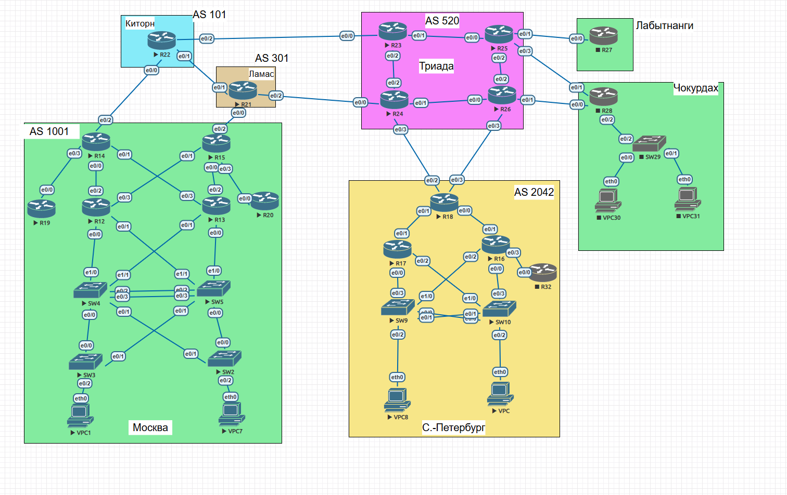

# iBGP: Москва full-mesh, RR в Триаде, приоритет Ламаса, ECMP в СПб



Лабораторная работа - продолжение [работы 6](../6.%20BGP/README.md).
Все eBGP-сессии оттуда сохранены как есть; здесь к ним добавлены iBGP в двух автономных
системах, политика приоритета провайдера и балансировка в офисе Санкт-Петербург.

## 1. Задача и допущения

Требования задания:

1. Настроить iBGP в офисе Москва между маршрутизаторами R14 и R15.
2. Настроить iBGP в провайдере Триада с использованием RR.
3. Настроить офис Москва так, чтобы приоритетным провайдером стал Ламас.
4. Настроить офис С.-Петербург так, чтобы трафик до любого офиса распределялся по двум линкам одновременно.
5. Все сети в лабораторной работе должны иметь IP-связность.
6. План работы и изменения зафиксированы в документации.

Решения, которые я принял до работы со стендом:

- **iBGP-сессии - по Loopback0** (`update-source Loopback0`, `bgp router-id` = лупбэк). TCP-сессия
  переживает деградацию любого отдельного интерфейса, но её судьба полностью зависит от
  IGP, я на этом споткнулся, раздел 5.1.
- **Москва - full-mesh.** BGP-роутеров в AS 1001 всего два (R14, R15): одна сессия,
  масштабировать нечего, RR здесь был бы лишним звеном.
- **RR для Триады - R25.** Это «чистый» внутренний роутер AS 520: у него нет eBGP-пиров,
  вся пограничная нагрузка (Ламас, СПб) сидит на R24 и R26. Полный mesh для четырёх
  роутеров даёт 6 сессий, с RR хватает 3. Одиночный RR - известная единая точка отказа
  (RFC 4456, §7), отказоустойчивость через второй RR в это задание не входила.
- **Приоритет Ламаса - через local-pref 200** (RFC 4271 §5) на входе R15 от Ламаса, а не weight:
  weight не передаётся соседям, и R14 про приоритет ничего бы не узнал.
- **СПб:** исходящий - ECMP по двум линиям (`maximum-paths 2` + `bgp bestpath as-path
  multipath-relax`), входящий - детерминированно через линию R24: на R18 висит
  `route-map PREPEND out` в сторону R26, который добавляет две копии нашего AS только в
  анонсы собственных сетей (`ip as-path access-list 1 permit ^$`).
- BGP - только IPv4, AF для IPv6 не поднимал: задание про IPv4-связность, IPv6-адресация
  колец и офисов осталась как в работах 4-6.
- Сети лабы по IPv4 в скоупе BGP - 11 префиксов: 9 лупбэков /32 (R14, R15, R18, R21-R26)
  плюс две офисные /16: 10.11.0.0/16 Москва и 10.12.0.0/16 СПб. Ровно 11 network entries
  лежит в BGP-таблице R14, дальше «все сети» везде означает этот набор. Узлы R27/R28
  (Лабытнанги, Чокурдах, сегмент 10.13.0.0/16), видимые на схеме, относятся к последующим
  работ: BGP-сессий для них на этом этапе нет, со стороны Триады к ним стоит только
  статика R25, проверкой этой работы не покрыты.

## 2. План: автономные системы и сессии

AS и роли без изменений с работы 6:

| AS | Название | Роутеры | Что добавлено в этой работе |
|---|---|---|---|
| 1001 | Офис Москва | R14, R15 | iBGP full-mesh, next-hop-self, LP 200 от Ламаса |
| 101 | Киторн | R22 | нет (резервный выход Москвы) |
| 301 | Ламас | R21 | нет (приоритетный провайдер Москвы) |
| 520 | Триада | R23, R24, R25, R26 | iBGP через RR R25 (peer-group RR-CLIENTS) |
| 2042 | Офис С.-Петербург | R18 | ECMP на приём из 520, PREPEND в сторону R26, redistribute в EIGRP |

Новые iBGP-сессии (все по Loopback0):

| # | Сессия | AS | Тип | Роли |
|---|---|---|---|---|
| 1 | R14 ↔ R15 | 1001 | iBGP full-mesh | оба пограничные (eBGP с Киторном и Ламасом) |
| 2 | R23 → R25 | 520 | iBGP, клиент RR | R23 - внутренний клиент |
| 3 | R24 → R25 | 520 | iBGP, клиент RR | R24 - граничный: eBGP с Ламасом и СПб |
| 4 | R26 → R25 | 520 | iBGP, клиент RR | R26 - граничный: eBGP с СПб |

eBGP-сессии работы 6 не тронуты: R14-R22 (101), R15-R21 (301), R22-R21 (101-301), R21-R24,
R24-R18, R26-R18.

Ключевой момент дизайна: **next-hop-self на сессиях клиентов к RR ставят только граничные R24 и
R26.** Без него R24 отдал бы RR маршрут 10.12.0.0/16 с next-hop 10.0.100.21 (интерфейс R18),
которого у внутреннего R23 нет в IGP, маршрут стал бы невалидным после рефлексии. С NH-self
next-hop заменяется на лупбэк 10.0.0.24, достижимый внутри AS 520 через IS-IS (работа 4).

## 3. Конфигурация

Фрагменты боевого состояния из `write memory` (EVE-NG Export CFG, 23.11.2026); опущены
строки, не относящиеся к заданию.

### 3.1 iBGP Москва (AS 1001)

```
! R14
router bgp 1001
 bgp router-id 10.0.0.14
 bgp log-neighbor-changes
 network 10.0.0.14 mask 255.255.255.255
 network 10.11.0.0 mask 255.255.0.0
 neighbor 10.0.0.15 remote-as 1001
 neighbor 10.0.0.15 update-source Loopback0
 neighbor 10.0.0.15 next-hop-self
 neighbor 10.0.100.2 remote-as 101          ! Киторн (работа 6)
!
! R15
router bgp 1001
 bgp router-id 10.0.0.15
 bgp log-neighbor-changes
 network 10.0.0.15 mask 255.255.255.255
 network 10.11.0.0 mask 255.255.0.0
 neighbor 10.0.0.14 remote-as 1001
 neighbor 10.0.0.14 update-source Loopback0
 neighbor 10.0.0.14 next-hop-self
 neighbor 10.0.100.14 remote-as 301         ! Ламас (работа 6)
 neighbor 10.0.100.14 route-map LP-LAMAS in
```

R14 и R15 не соединены напрямую: транзит между их лупбэками идёт через R12/R13 (OSPF area 10),
поэтому сессия «по лупбэкам» живёт полностью состоянием IGP, см. 5.1.

### 3.2 iBGP Триада через route reflector (AS 520)

R25 - route reflector, клиенты описаны одним peer-group:

```
! R25
router bgp 520
 bgp router-id 10.0.0.25
 bgp log-neighbor-changes
 network 10.0.0.25 mask 255.255.255.255
 neighbor RR-CLIENTS peer-group
 neighbor RR-CLIENTS remote-as 520
 neighbor RR-CLIENTS update-source Loopback0
 neighbor RR-CLIENTS route-reflector-client
 neighbor 10.0.0.23 peer-group RR-CLIENTS
 neighbor 10.0.0.24 peer-group RR-CLIENTS
 neighbor 10.0.0.26 peer-group RR-CLIENTS
```

Клиенты: R23 - только сессия к RR; R24 и R26 - граничные, к их конфигурации из работы 6
добавлены та же сессия к RR и next-hop-self:

```
! R23
router bgp 520
 bgp router-id 10.0.0.23
 network 10.0.0.23 mask 255.255.255.255
 neighbor 10.0.0.25 remote-as 520
 neighbor 10.0.0.25 update-source Loopback0
!
! R24 (eBGP-строки из работы 6)
 neighbor 10.0.0.25 remote-as 520
 neighbor 10.0.0.25 update-source Loopback0
 neighbor 10.0.0.25 next-hop-self
 neighbor 10.0.100.17 remote-as 301
 neighbor 10.0.100.21 remote-as 2042
!
! R26 (eBGP-строка из работы 6)
 neighbor 10.0.0.25 remote-as 520
 neighbor 10.0.0.25 update-source Loopback0
 neighbor 10.0.0.25 next-hop-self
 neighbor 10.0.100.25 remote-as 2042
```

### 3.3 Приоритетный провайдер Москвы - Ламас

Единственная команда политики на R15 (AS 1001 получает транзит в Ламас напрямую и через
Киторн на R14):

```
! R15
route-map LP-LAMAS permit 10
 set local-preference 200
!
 neighbor 10.0.100.14 route-map LP-LAMAS in    ! уже в листинге 3.1
```

Local-pref - атрибут well-known discretionary, передаётся внутри AS: R15 проставляет 200
анонсам от Ламаса, по iBGP они приходят на R14 и там выигрывают у внешних анонсов от Киторна
с LP 100. Итоговый выбор пути на R14 - раздел 4.2.

### 3.4 Балансировка СПб по двум линиям (AS 2042)

```
! R18
router bgp 2042
 bgp router-id 10.0.0.18
 bgp log-neighbor-changes
 bgp bestpath as-path multipath-relax
 network 10.0.0.18 mask 255.255.255.255
 network 10.12.0.0 mask 255.255.0.0
 neighbor 10.0.100.22 remote-as 520         ! R24, линия 19 (работа 6)
 neighbor 10.0.100.26 remote-as 520         ! R26, линия 20 (работа 6)
 neighbor 10.0.100.26 route-map PREPEND out
 maximum-paths 2
!
ip as-path access-list 1 permit ^$
route-map PREPEND permit 10
 match as-path 1
 set as-path prepend 2042 2042
```

Как это читается:

- `maximum-paths 2` без `multipath-relax` пускает в ECMP только пути с **одинаковым содержимым**
  AS-path; `multipath-relax` ослабляет требование до равенства длин, поэтому пути через R24 и
  через R26 попадают в ECMP даже когда их содержимое разъехлось (например, после смены best
  источника рефлексии у RR).
- `PREPEND out` направлен только на R26 и матчится только на `^$`: свои сети (лупбэк и
  10.12.0.0/16). Смысл: входящий трафик из Триады в СПб идёт детерминированно через R24
  (на R26 наш анонс выглядит как `2042 2042 2042` и проигрывает рефлексированному `2042`),
  а исходящий из СПб размазан по обеим линиям через ECMP.
- Extern-маршруты отдаём внутрь офисного EIGRP-домена (named mode, работа 5), иначе VPC8
  и машины 10.12.0.0/16 ничего не видят за пределами офиса:

```
! R18
router eigrp SPB
 address-family ipv4 unicast autonomous-system 2042
  topology base
   redistribute bgp 2042 metric 1000000 100 255 1 1500
```

### 3.5 Что пришлось починить в IGP: area 10 из stub → NSSA

После подъёма iBGP часть пар в первой матрице пингов не сходился: у R12/R13 (транзит Москвы и
шлюз VPC1) не было явных маршрутов к лупбэкам внешних AS. Это ожидаемо: stub-зона не
принимает внешние LSA (type-5), и внутри неё от внешних сетей живёт только default от ABR.
Единственный механизм занести конкретные внешние маршруты в зону - type-7, а он бывает только
в NSSA, поэтому зону конвертируем. Конвертация зоны 10 в NSSA на всех четырёх роутерах Москвы:

```
! R12, R13 (внутренние)
router ospf 1
 area 10 nssa
!
! R14, R15 (ABR)
router ospf 1
 area 10 nssa default-information-originate
 area 10 range 10.11.0.0 255.255.0.0          ! суммария из работы 3
```

Точечная раздача внешних /32 из BGP в OSPF - только лупбэки соседних AS, без транзитных
линков и офисных сетей (история с prefix-list - 5.2):

```
! R15
ip prefix-list REDIST-EX seq 5  permit 10.0.0.18/32
ip prefix-list REDIST-EX seq 10 permit 10.0.0.21/32
ip prefix-list REDIST-EX seq 15 permit 10.0.0.22/32
ip prefix-list REDIST-EX seq 20 permit 10.0.0.23/32
ip prefix-list REDIST-EX seq 25 permit 10.0.0.24/32
ip prefix-list REDIST-EX seq 30 permit 10.0.0.25/32
ip prefix-list REDIST-EX seq 35 permit 10.0.0.26/32
route-map BGP2OSPF permit 10
 match ip address prefix-list REDIST-EX
!
router ospf 1
 redistribute bgp 1001 subnets route-map BGP2OSPF
```

На R14/R15 без изменений наследие работы 3: `area 101 stub no-summary` и
`area 102 filter-list prefix NO-AREA101 in`.

## 4. Проверки

### 4.1 Сессии: 10 сессий, все Established

`show ip bgp summary` на всех девяти BGP-роутерах (PfxRcd - префиксов получено):

| Роутер | Сосед | AS | Роль | Up/Down | PfxRcd |
|---|---|---|---|---|---|
| R14 | 10.0.0.15 | 1001 | iBGP | 00:22:22 | 10 |
| R14 | 10.0.100.2 | 101 | eBGP Киторн | 1d02h | 8 |
| R15 | 10.0.0.14 | 1001 | iBGP | 00:22:50 | 2 |
| R15 | 10.0.100.14 | 301 | eBGP Ламас | 1d02h | 8 |
| R21 | 10.0.100.6 / .13 / .18 | 101 / 1001 / 520 | eBGP | 1d02h | 4 / 3 / 6 |
| R22 | 10.0.100.1 / .5 | 1001 / 301 | eBGP | 1d02h | 10 / 10 |
| R23 | 10.0.0.25 | 520 | iBGP клиент RR | 00:58:19 | 10 |
| R24 | 10.0.0.25 | 520 | iBGP клиент RR | 00:58:32 | 3 |
| R24 | 10.0.100.17 / .21 | 301 / 2042 | eBGP | 1d02h | 5 / 2 |
| R25 | 10.0.0.23 / .24 / .26 | 520 | iBGP RR, клиенты | ~00:59 | 1 / 8 / 1 |
| R26 | 10.0.0.25 | 520 | iBGP клиент RR | 00:59:05 | 10 |
| R26 | 10.0.100.25 | 2042 | eBGP | 1d02h | 2 |
| R18 | 10.0.100.22 / .26 | 520 | eBGP | 1d02h | 9 / 9 |

Счётчики сами объясняют дизайн: R15 получает от R14 только 2 префикса (анонсы самой Москвы,
остальное R14 предпочитает через R15 и по split-horizon не отдаёт). RR R25 видит от клиентов
1/8/1: внутренний R23 шлёт только свой лупбэк; граничный R24 - все свои внешние best; R26 -
тоже только лупбэк, потому что лучшие пути в сети СПб у него рефлексируемые через RR
(as-path `2042` короче прямого `2042 2042 2042`, разбор в 4.3), а полученные от RR он назад
RR не отправляет. R23 и R26 получают от RR полные 10 префиксов.

### 4.2 Требование 3: Москва предпочитает Ламас

`show ip bgp 10.0.0.18` на R14: best выбран путь через R15 (коридор Ламаса) с LP 200,
а не внешний через Киторн с LP 100:

```
Paths: (2 available, best #1, table default, RIB-failure(17))
  301 520 2042
    10.0.0.15 (metric 21) from 10.0.0.15 (10.0.0.15)
      Origin IGP, metric 0, localpref 200, valid, internal, best
  101 301 520 2042
    10.0.100.2 from 10.0.100.2 (10.0.0.22)
      Origin IGP, localpref 100, valid, external
```

Traceroute R14 → 10.0.0.18 подтверждает физический коридор (R12/R13 → R15 → Ламас R21 →
Триада R24 → R18), транзит через Киторн не используется:

```
R14#traceroute 10.0.0.18 source loopback 0 timeout 1 probe 2
  1 10.0.1.1 / 10.0.1.5          ! R12 / R13 - ECMP внутри Москвы
  2 10.0.1.18 / 10.0.1.14        ! R15 с обеих сторон
  3 10.0.100.14                  ! R21, Ламас
  4 10.0.100.18                  ! R24, Триада
  5 10.0.100.21                  ! R18
```

`RIB-failure(17)` в выводе - ожидаемое следствие сравнения AD, разбор в 5.4.

### 4.3 Требование 2: видны атрибуты route reflector

`show ip bgp 10.12.0.0` на R26: маршрут пришёл рефлексией через R25, это видно по
Originator/Cluster; прямой eBGP-путь с R18 проигрывает из-за prepending:

```
Paths: (2 available, best #1, table default)
  2042
    10.0.0.24 (metric 20) from 10.0.0.25 (10.0.0.25)
      Origin IGP, metric 1536000, localpref 100, valid, internal, best
      Originator: 10.0.0.24, Cluster list: 10.0.0.25
  2042 2042 2042
    10.0.100.25 from 10.0.100.25 (10.0.0.18)
      Origin IGP, metric 1536000, localpref 100, valid, external
```

### 4.4 Требование 4: СПб льётся по двум линиям одновременно

`show ip bgp 10.11.0.0` на R18: оба eBGP-пути помечены multipath, префикс в ECMP:

```
Paths: (2 available, best #2, table default)
Multipath: eBGP
  520 301 1001
    10.0.100.26 from 10.0.100.26 (10.0.0.26)
      Origin IGP, localpref 100, valid, external, multipath(oldest)
  520 301 1001
    10.0.100.22 from 10.0.100.22 (10.0.0.24)
      Origin IGP, localpref 100, valid, external, multipath, best
```

В RIB два next-hop с равным traffic share, и traceroute это подтверждает: первый хоп
через обе линии (пробеги чередуют .22 и .26):

```
R18#traceroute 10.0.0.14 source loopback 0 timeout 1 probe 2
  1 10.0.100.22 / 10.0.100.26     ! R24 / R26 - обе линии Триады
  2 10.0.100.17 / 10.0.2.13       ! коридор через R21 / через кольцо Триады
...
R18#show ip route 10.0.0.14
  Routing Descriptor Blocks:
  * 10.0.100.26, from 10.0.100.26, traffic share count is 1
    10.0.100.22, from 10.0.100.22, traffic share count is 1
```

### 4.5 Требование 5: связность всех сетей

Матрица пингов loopback-источник→loopback-назначение: 9 BGP-роутеров × 8 чужих лупбэков =
**72/72, потерь 0%** (полный вывод: 9 строк по 8 назначений):

```
R14: 10.0.0.15 100% | 10.0.0.18 100% | 10.0.0.21 100% | ... | 10.0.0.26 100%
R15: 10.0.0.14 100% | 10.0.0.18 100% | ... | 10.0.0.26 100%
...
R26: 10.0.0.14 100% | 10.0.0.15 100% | ... | 10.0.0.25 100%
```

Связность офисных сегментов проверялась с конечных машин: VPC1 (10.11.10.10, Москва) ↔
VPC8 (10.12.10.10, СПб) - 5/5 в обе стороны (ttl=58, транзит через 6 хопов), VPC1 →
10.0.0.24 5/5. Суммарно покрыты все 11 IPv4-сетей лабы: 9 лупбэков в матрице, две офисные
/16 - анонсами `network` и пингом VPC↔VPC.

## 5. Что оказалось неочевидным

### 5.1 `area 10 nssa no-summary` уронил iBGP

Конвертируя area 10 в NSSA, на ABR я сначала поставил строгий вариант
`area 10 nssa no-summary`, и iBGP R14↔R15 завис в Idle. Сессия построена по лупбэкам,
транзит идёт через area 10, а `no-summary` на ABR отсекает в зону межзонные type-3: R12/R13
перестали видеть /32 лупбэков R14 и R15, и от всей маршрутизации между концами сессии у них
остался только default на ABR, TCP-сессия этого не выдержала.
После замены на `area 10 nssa default-information-originate` событие вышло сразу:

```
R14(config-router)# no area 10 nssa no-summary
R14(config-router)# area 10 nssa default-information-originate
*Nov 23 17:32:30.146: %BGP-5-ADJCHANGE: neighbor 10.0.0.15 Up
```

Вывод: чем строже фильтруешь зону, через которую транзитится iBGP по лупбэкам, тем сильнее
рассинхрон «IGP как бы поднято, BGP лежит». Default-маршрут ABR в NSSA при этом пришлось
генерить явно (`default-information-originate`): в отличие от stub, NSSA без no-summary
его не добавляет.

### 5.2 `10.0.0.0/8 le 32` - это не «хостовые маршруты»

Первый вариант redistribute фильтровался prefix-list вида `permit 10.0.0.0/8 le 32`, и это
**все** префиксы 10/8 длиной до /32, то есть вся лаба целиком вместе с транзитными линками
и офисными сегментами. В OSPF улетело всё, что к тому моменту накопилось в BGP-таблице.
Заменил на явный список REDIST-EX из семи конкретных /32 (раздел 3.5).

### 5.3 Два `match ip address` в одном entry - это ИЛИ, а match разных типов - И

При замене фильтра на R15 я добавил `match ip address prefix-list REDIST-EX` в существующий
`route-map BGP2OSPF`, где уже висел старый `match ip address prefix-list REDIST-HOSTS`, и
фильтр стал пропускать **всё**: несколько match'ей одного типа в одном entry объединяются
логическим ИЛИ (префикс матчится хотя бы одним списком - проходит). Match'и разных типов
(`match ip address` + `match metric`, например) наоборот, объединяются И. Помог только порядок
`no match ip address prefix-list REDIST-HOSTS` → `match ip address prefix-list REDIST-EX`.

### 5.4 RIB-failure: OSPF N2 (AD 110) бьёт iBGP (AD 200)

На R14 лучший BGP-путь до 10.0.0.18 (тот самый, LP 200) не попадает в таблицу маршрутизации:
`RIB-failure(17)`, потому что в RIB лежит OSPF N2-маршрут (AD 110), который R15 сам же туда
раздал из того же BGP. Связность и выбор пути не сломаны, физический коридор тот же самый
(R15 → Ламас, видно в traceroute 4.2), поэтому оставил как есть: менять `distance bgp`
ради косметики значило бы исказить сравнение протоколов на стенде.

## 6. Откат

Приводит стенд к состоянию работы 6 (eBGP без iBGP). Конфигурации сохранены
(`write memory` + EVE-NG Export CFG на всех 11 узлах), откат зеркально настройке:

```
! R12, R13: вернуть area 10 в stub (baseline работы 3)
router ospf 1
 no area 10 nssa
 area 10 stub
!
! R14: снять только iBGP-строки, eBGP с Киторном из работы 6 остаётся
router ospf 1
 no area 10 nssa default-information-originate
 no area 10 nssa
 area 10 stub
router bgp 1001
 no neighbor 10.0.0.15 update-source Loopback0
 no neighbor 10.0.0.15 next-hop-self
 no neighbor 10.0.0.15 remote-as 1001
!
! R15: iBGP-строки, LP-LAMAS и раздачу в OSPF, eBGP с Ламасом из работы 6 оставляем
router ospf 1
 no redistribute bgp 1001 subnets route-map BGP2OSPF
 no area 10 nssa default-information-originate
 no area 10 nssa
 area 10 stub
router bgp 1001
 no neighbor 10.0.0.14 route-map LP-LAMAS in
 no neighbor 10.0.0.14 update-source Loopback0
 no neighbor 10.0.0.14 next-hop-self
 no neighbor 10.0.0.14 remote-as 1001
no route-map LP-LAMAS permit 10
no route-map BGP2OSPF permit 10
no ip prefix-list REDIST-EX
no ip prefix-list ANY
!
! R23, R25: BGP-процессы созданы в этой работе
no router bgp 520
!
! R24, R26: снять только iBGP-строки к RR, eBGP из работы 6 остаётся
router bgp 520
 no neighbor 10.0.0.25 update-source Loopback0
 no neighbor 10.0.0.25 next-hop-self
 no neighbor 10.0.0.25 remote-as 520
!
! R18: снять ECMP, prepend и раздачу в EIGRP
router bgp 2042
 no neighbor 10.0.100.26 route-map PREPEND out
 no maximum-paths 2
 no bgp bestpath as-path multipath-relax
no route-map PREPEND permit 10
no ip as-path access-list 1
router eigrp SPB
 address-family ipv4 unicast autonomous-system 2042
  topology base
   no redistribute bgp 2042 metric 1000000 100 255 1 1500
```

## 7. Соответствие требованиям

| # | Требование | Где выполнено | Чем подтверждено |
|---|---|---|---|
| 1 | iBGP Москва R14-R15 | 3.1 | 4.1: сессия Up, 10/2 префикса |
| 2 | iBGP Триада через RR | 3.2 | 4.1: RR R25 + 3 клиента; 4.3: Originator/Cluster list |
| 3 | Приоритетный провайдер - Ламас | 3.3 | 4.2: best с LP 200 через R15, traceroute коридором Ламаса |
| 4 | СПб: трафик по двум линкам одновременно | 3.4 | 4.4: Multipath eBGP, 2 next-hop в RIB, первый хоп traceroute чередует линии |
| 5 | Все сети имеют IP-связность | 3.1-3.5 | 4.5: матрица 72/72 (0% потерь), VPC1↔VPC8 5/5 |
| 6 | План и изменения в документации | весь README | нет |

## Источники

- Лекции 21 «Основы iBGP» и 22 «Масштабируемость и дизайн iBGP» курса «Сетевой инженер».
- RFC 4271 (BGP-4): attributes, local-preference; RFC 4456 (BGP Route Reflection): роли RR,
  Originator ID, Cluster List, известная проблема одиночного RR.
- [Работа 6: eBGP между офисами и провайдерами](../6.%20BGP/README.md): базовые eBGP-сессии
  и адресация линков; [работа 3](../3.%20OSPF/README.md): baseline зон OSPF;
  [работа 4](../4.%20IS-IS/README.md): IS-IS внутри Триады;
  [работа 5](../5.%20EIGRP/README.md): EIGRP named-mode в СПб.
